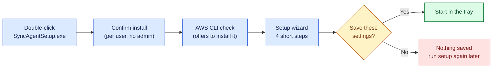
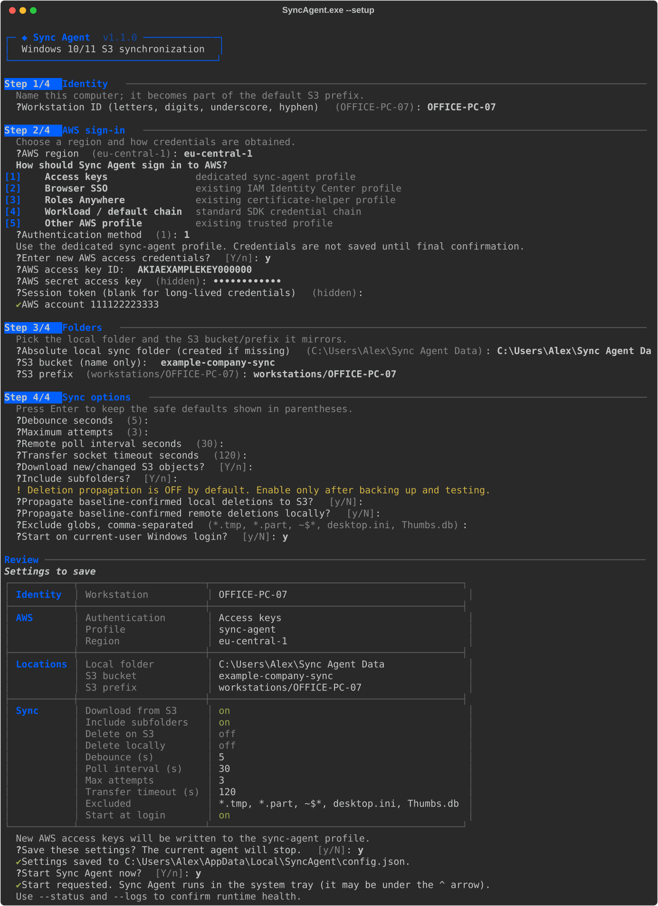
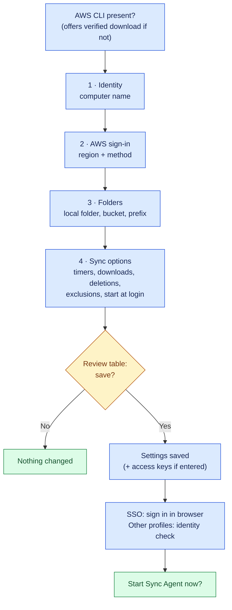
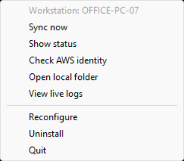
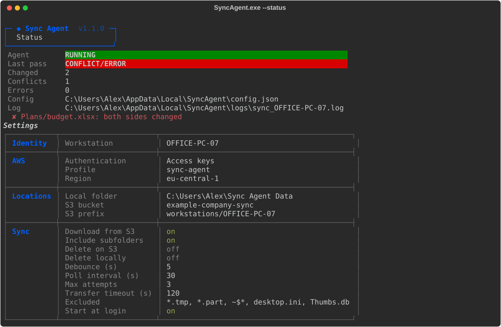
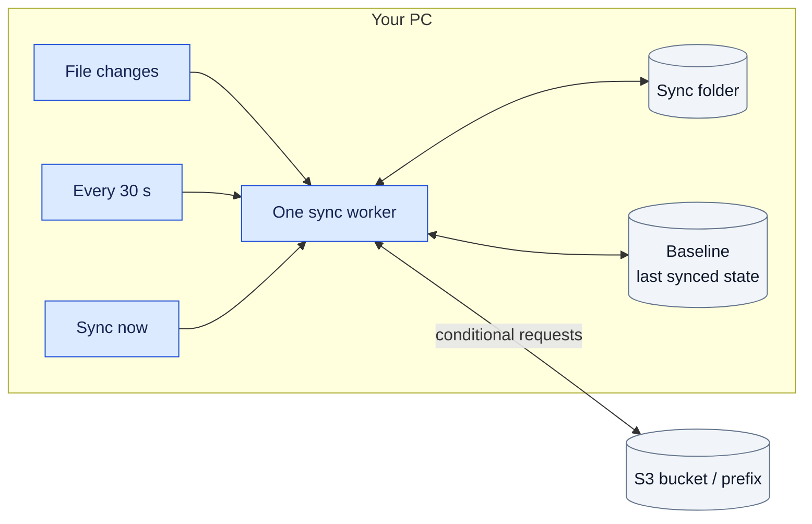
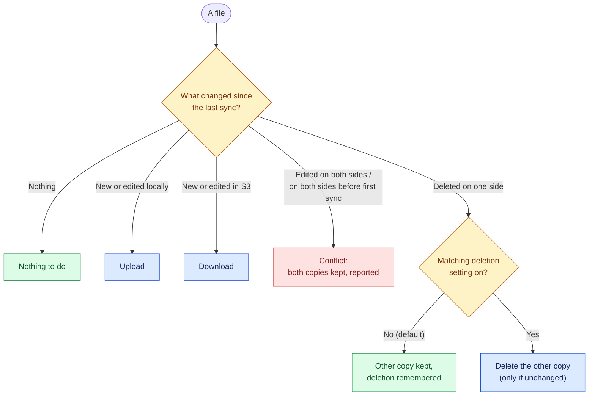

<p align="center">
  
</p>

<h1 align="center">Sync Agent</h1>

<p align="center">
  Keep a Windows folder in sync with an Amazon S3 bucket, safely.<br>
  Windows 10 / 11 · runs in the system tray · no administrator rights needed
</p>

<p align="center">
  <a href="#quick-start">Quick start</a> ·
  <a href="#setting-it-up">Setup</a> ·
  <a href="#configuration-settings">Settings</a> ·
  <a href="#everyday-use">Everyday use</a> ·
  <a href="#how-syncing-works">How it works</a> ·
  <a href="docs/troubleshooting.md">Troubleshooting</a>
</p>

---

Sync Agent watches a local folder and an S3 "folder" (a bucket prefix) and copies new and changed files in both directions. It is deliberately **conservative**: it never picks a winner by timestamp, never overwrites a file that changed on both sides, and does not delete anything unless you turn deletion on.

- **One-file installer.** Double-click `SyncAgentSetup.exe`; a guided setup asks a few questions and starts syncing.
- **Lives in the tray.** No console window; the icon shows when it is syncing (amber dot) or needs attention (red dot).
- **Safe by design.** Conditional S3 writes, atomic downloads, conflict detection, deletions off by default, and no process killing.
- **Flexible sign-in.** Access keys, company SSO (IAM Identity Center), Roles Anywhere, existing AWS profiles or the AWS workload chain.
- **Easy to deploy.** Ship one prepared settings file next to the installer to set up many computers without questions.

<p align="center">
  
</p>

## Contents

- [Quick start](#quick-start)
- [Setting it up](#setting-it-up)
- [Configuration settings](#configuration-settings)
- [Everyday use](#everyday-use)
- [How syncing works](#how-syncing-works)
- [Installing on other computers](#installing-on-other-computers)
- [Uninstalling](#uninstalling)
- [Building from source](#building-from-source)
- [Project structure](#project-structure)
- [Documentation](#documentation)

## Quick start

**You need:** a 64-bit Windows 10 or 11 PC, an existing S3 bucket, and AWS credentials allowed to use it ([minimum permissions](docs/authentication.md#minimum-aws-permissions)).

1. **Get the installer.** Build `dist\SyncAgentSetup.exe` with [`build.bat`](#building-from-source), or download the **SyncAgentSetup-windows** artifact from the repository's *Windows distribution* workflow.
2. **Run it.** Double-click `SyncAgentSetup.exe` and confirm. If Windows shows *"Windows protected your PC"*, click **More info → Run anyway** (builds are unsigned until a code-signing certificate is configured).
3. **Answer the setup questions** ([explained below](#setting-it-up)). Defaults are pre-filled; press **Enter** to accept them.
4. **Start it.** Answer **Y** to *Start Sync Agent now?*. The tray icon appears; it may be under the **^** arrow.

Put a file in your sync folder: it appears in S3 a few seconds later.



> **First time?** Use an empty test folder and an empty, versioned test bucket or prefix, and keep both deletion options **off**. More detail is in the [installation guide](docs/installation.md).

## Setting it up

The setup wizard opens automatically after installing. You can run it again any time from the Start Menu (**Sync Agent**, when not yet configured) or with `SyncAgent.exe --setup`. Each answer is checked straight away, and a mistake only re-asks that one question.

<details>
<summary><b>See a complete setup session</b></summary>



</details>



### Step 1 · Identity

| Question | Default | What to enter |
| --- | --- | --- |
| Workstation ID | your computer name | A short name for this PC (letters, digits, `-`, `_`). It names the log file and the suggested S3 prefix. |

### Step 2 · AWS sign-in

| Question | Default | What to enter |
| --- | --- | --- |
| AWS region | `eu-central-1` | The region of your bucket, e.g. `us-east-1`. |
| Authentication method | `1` (or your current choice) | How Sync Agent gets credentials (see below). |

| Choice | Use it when | You will be asked for |
| --- | --- | --- |
| **1 · Access keys** | Simple setups with a dedicated IAM user | Access key ID, secret (hidden), optional session token. Checked with AWS immediately, saved only after the final review, and only to the `sync-agent` AWS profile. |
| **2 · Browser SSO** | Your company signs in to AWS through IAM Identity Center | The name of a profile created with `aws configure sso --profile NAME`. Browser sign-in is offered after saving. |
| **3 · Roles Anywhere** | An administrator installed a certificate and AWS signing helper | The name of that profile. |
| **4 · Workload / default chain** | Sync Agent runs inside AWS (EC2, WorkSpaces) | Nothing: the standard AWS SDK search order is used. |
| **5 · Other AWS profile** | You already have a named profile (e.g. assume-role) | The profile name. |

The wizard lists the AWS profiles it finds on the computer. Details and IAM policy: [docs/authentication.md](docs/authentication.md).

### Step 3 · Folders

| Question | Default | What to enter |
| --- | --- | --- |
| Absolute local sync folder | `%USERPROFILE%\Sync Agent Data` | The folder to keep in sync; created if missing. It cannot be a drive root, your user folder itself, a link/junction, or inside Sync Agent's own folders. Avoid folders already synced by OneDrive or Dropbox. |
| S3 bucket (name only) | — | The bucket **name only**, e.g. `example-company-sync` (an `s3://` prefix is stripped for you). The bucket must exist. |
| S3 prefix | `workstations/<workstation ID>` | The "folder" inside the bucket, e.g. `team/reports`. Only objects under it are touched. |

### Step 4 · Sync options

Press **Enter** to keep each safe default.

| Question | Default | Meaning |
| --- | --- | --- |
| Debounce seconds | `5` | Wait this long after a local change before syncing, so a burst of saves becomes one upload. |
| Maximum attempts | `3` | Tries per S3 request on temporary AWS errors. |
| Remote poll interval seconds | `30` | How often S3 is checked for changes made elsewhere. |
| Transfer socket timeout seconds | `120` | Give up on a transfer that makes no progress for this long. |
| Download new/changed S3 objects? | Yes | **No** makes Sync Agent upload-only. |
| Include subfolders? | Yes | **No** syncs only files directly in the folder. |
| Propagate baseline-confirmed local deletions to S3? | **No** | ⚠ Destructive. Deletes the S3 copy when you delete a synced file locally. |
| Propagate baseline-confirmed remote deletions locally? | **No** | ⚠ Destructive. Deletes your local file when its S3 copy is deleted. |
| Exclude globs, comma-separated | `*.tmp, *.part, ~$*, desktop.ini, Thumbs.db` | Files never synced (comma-separated, case-sensitive). |
| Start on current-user Windows login? | No | Start Sync Agent in the tray when you sign in. |

Finally a **review table** shows everything. Nothing is written, and a running agent is not touched, until you answer **Y** to *Save these settings?*.

## Configuration settings

Settings are stored in `%LOCALAPPDATA%\SyncAgent\config.json`, one file per Windows user. **No passwords or AWS keys are ever stored there.** Change them with **Reconfigure** in the tray menu (or `SyncAgent.exe --reconfigure`), which lets you edit one group (identity, sign-in, folders or options) and then review and save.

| Setting | Default | Description |
| --- | --- | --- |
| `workstation_id` | computer name | Name of this computer; letters, digits, `_`, `-` (max 64). |
| `local_path` | *(required)* | Absolute path of the folder to sync. Environment variables are not expanded. |
| `s3_bucket` | *(required)* | Bucket name (not a URL). |
| `s3_prefix` | *(required)* | Path inside the bucket, without leading/trailing `/`. |
| `region` | `eu-central-1` | AWS region. |
| `auth_method` | `access_keys` | `access_keys`, `sso`, `roles_anywhere`, `profile` or `workload_role`. |
| `aws_profile` | `sync-agent` | AWS profile name. Must be `sync-agent` for access keys; omitted for `workload_role`. |
| `sync_from_s3` | `true` | Download changes from S3 (`false` = upload only). |
| `recursive` | `true` | Include subfolders. |
| `delete_on_s3` | `false` | ⚠ Delete in S3 when a synced file is deleted locally. |
| `delete_local` | `false` | ⚠ Delete locally when a synced object is deleted in S3. |
| `exclude_patterns` | `["*.tmp", "*.part", "~$*", "desktop.ini", "Thumbs.db"]` | Wildcard patterns matched against file names and relative paths (case-sensitive). |
| `debounce_secs` | `5` | 0–3600. Quiet time after a local change before syncing. |
| `poll_interval` | `30` | 5–86400. Seconds between checks for S3 changes. |
| `max_retries` | `3` | 1–10. Attempts per S3 request. |
| `transfer_timeout` | `120` | 10–3600. Seconds without progress before a transfer is abandoned. |
| `autostart` | `false` | Start in the tray at Windows sign-in. |
| `notifications` | `true` | Show a Windows notification when a pass ends with conflicts or errors. |

Example `config.json`:

```json
{
  "workstation_id": "OFFICE-PC-07",
  "local_path": "C:\\Users\\Alex\\Sync Agent Data",
  "s3_bucket": "example-company-sync",
  "s3_prefix": "workstations/OFFICE-PC-07",
  "region": "eu-central-1",
  "auth_method": "sso",
  "aws_profile": "company-sso",
  "sync_from_s3": true,
  "delete_on_s3": false,
  "delete_local": false,
  "autostart": true
}
```

> Changing the folder, bucket, prefix, profile or sign-in method starts a fresh sync history, so the next pass treats files present on both sides as conflicts rather than overwriting them. Full rules, validation details and more examples are in [docs/configuration.md](docs/configuration.md).

## Everyday use

Right-click the tray icon:



| Menu item | What it does |
| --- | --- |
| **Sync now** | Run a pass immediately. |
| **Show status** | Last result, conflicts/errors and all settings. |
| **Sign in (SSO)** | Browser sign-in (SSO only). |
| **Check AWS identity** | Shows which AWS account/role is used. |
| **Open local folder** | Opens the sync folder in Explorer. |
| **View live logs** | Follows the log as it is written. |
| **Reconfigure** | Change settings (stops and restarts the agent). |
| **Uninstall** | Removes the program, keeps your data. |
| **Quit** | Stops syncing until next start. |

<br clear="right">

| Tray icon | Meaning |
| --- | --- |
| Plain | Up to date. |
| Amber dot | A sync pass is running. |
| Red dot | The last pass had conflicts or errors. Open **Show status**. |

<details>
<summary><b>See the status screen</b></summary>



</details>

The same actions are available from a terminal. The installer does not change `PATH`, so use the full path, `"%LOCALAPPDATA%\Programs\SyncAgent\SyncAgent.exe"`:

```bat
SyncAgent.exe                       :: start in the tray (or setup if not configured)
SyncAgent.exe --status              :: state, last pass, settings
SyncAgent.exe --logs [--follow]     :: recent log lines
SyncAgent.exe --setup               :: full setup wizard
SyncAgent.exe --reconfigure         :: change some settings
SyncAgent.exe --login               :: SSO browser sign-in
SyncAgent.exe --check-auth          :: verify AWS identity (does not prove S3 access)
SyncAgent.exe --stop                :: stop the running agent safely
SyncAgent.exe --import-config FILE [--yes]   :: apply prepared settings
SyncAgent.exe --uninstall
SyncAgent.exe --version
```

## How syncing works



For every file, Sync Agent compares both sides with the **baseline**, a record of what both sides looked like after the last successful sync:



Safety rules that always apply:

- **Uploads** are snapshotted and use S3 conditional writes, so another computer's newer version is never silently overwritten.
- **Downloads** go to a temporary file and replace the local file atomically, only if it has not changed meanwhile.
- **Conflicts** are never merged or overwritten; resolve them by keeping the version you want ([how](docs/troubleshooting.md#conflicts)).
- **Unsafe names** (Windows reserved names, case-only duplicates, links/junctions) are skipped and reported.
- Uploads over 5 GiB are refused. Empty folders, permissions and metadata are not synced.
- Sync is not a backup: enable **S3 bucket versioning** and keep independent backups.

The full design, with start-up, scheduling, stop and installer flowcharts, is in [docs/architecture.md](docs/architecture.md).

## Installing on other computers

Copy **only `SyncAgentSetup.exe`**; it contains the whole application. To skip the wizard on each computer, put a prepared settings file beside it:

```text
USB stick or share\
├── SyncAgentSetup.exe
└── SyncAgent.config.json   ← edited copy of examples/SyncAgent.config.example.json
```

```bat
SyncAgentSetup.exe --yes    :: install, apply SyncAgent.config.json and start, without questions
```

- The settings file holds no credentials. Each computer still needs a working AWS profile (SSO, Roles Anywhere, or keys in the `sync-agent` profile).
- Use a `local_path` that exists on every computer, e.g. `C:\Users\Public\Sync Agent Data`; `%USERPROFILE%` is not expanded.
- Every computer using the same file shares the same `s3_prefix`, and therefore syncs with the others. Give each computer its own copy with a different prefix if they should be separate.

Other installer options: `--config FILE` (settings file elsewhere), `--no-configure` (install only), `--no-startup` (never start at login). Details: [docs/configuration.md](docs/configuration.md#prepared-settings-for-many-computers).

## Uninstalling

Use **Settings → Apps → Installed apps → Sync Agent → Uninstall**, the tray menu's **Uninstall**, or `SyncAgent.exe --uninstall`.

This removes the program, the Start Menu shortcut, the Installed apps entry and the login startup entry. It **keeps** your sync folder, everything in S3, settings and logs (`%LOCALAPPDATA%\SyncAgent`), the AWS CLI and your AWS profiles. To remove those too, see [troubleshooting](docs/troubleshooting.md#removing-sync-agent-completely).

## Building from source

Requires Windows and 64-bit [Python](https://www.python.org/downloads/windows/) 3.10+ (3.12 recommended).

```bat
git clone <this repository>
cd sync_agent
build.bat
```

`build.bat` creates an isolated environment, runs the full test suite, and produces:

| Output | Use |
| --- | --- |
| `dist\SyncAgentSetup.exe` | The single file to give to users |
| `dist\SyncAgent\` | The same application as a folder (install with its `install.bat`) |

Run the tests on their own with `python -m pip install -r requirements-dev.txt` then `python -m pytest`. See the [development guide](docs/development.md) and [testing guide](docs/testing.md).

## Project structure

```text
├── src/            Application source (entry point: src/main.py)
├── scripts/        install / uninstall / AWS CLI PowerShell scripts shipped with the app
├── examples/       Prepared settings template
├── docs/           Guides, flowcharts and screenshots
├── tests/          Offline test suite (+ opt-in native and live tests)
├── build.bat       Builds the installer and application folder
├── pyproject.toml  Project metadata and pytest settings
└── requirements*.txt
```

## Documentation

| Guide | Contents |
| --- | --- |
| [Installation](docs/installation.md) | Step-by-step install, first run and first tests |
| [Configuration](docs/configuration.md) | Every setting, validation rules, examples, mass deployment |
| [Authentication](docs/authentication.md) | The five sign-in methods and a least-privilege IAM policy |
| [Architecture](docs/architecture.md) | How it works, with flowcharts; files it creates |
| [Troubleshooting](docs/troubleshooting.md) | Common problems and fixes |
| [Testing](docs/testing.md) | Test levels, native and live acceptance checklist |
| [Development](docs/development.md) | Repository layout, running from source, building, releasing |
| [Changelog](CHANGELOG.md) | What changed in each version |
| [Presentation](docs/presentation/Sync-Agent-How-It-Works.pptx) | 16-slide PowerPoint overview with speaker notes |

## Status and safety

| Area | Status |
| --- | --- |
| Automated tests | 211 passing on every build |
| Windows 11 | Packaged install / upgrade / uninstall tests and the 20-check acceptance script pass |
| Windows 10 | Pending: run [`scripts/acceptance-test.ps1`](scripts/acceptance-test.ps1) (one command) on a Windows 10 PC |
| Live S3 | Passed on 2026-10-22 against a test bucket in eu-central-1: conditional operations and full end-to-end sync, test objects cleaned up |
| Code signing | Built into `build.bat` and CI, verified with a test certificate; needs a real certificate ([how](docs/development.md#code-signing)) |

Run the pending checks with disposable resources before syncing valuable data: see [docs/testing.md](docs/testing.md).
