# ⚙️ HTE Sync Agent

> **AWS S3 Bidirectional Sync Agent for Windows**
> Replaces SyncTrayzor / SyncThing with direct AWS S3 sync.
> Runs silently in the system tray. Auto-starts on Windows login.


---

## Table of Contents

- [Overview](#overview)
- [Features](#features)
- [File Structure](#file-structure)
- [Architecture](#architecture)
- [Prerequisites](#prerequisites)
- [Build](#build)
- [Installation](#installation)
- [First-Time Setup](#first-time-setup)
- [Agent Runtime](#agent-runtime)
- [System Tray](#system-tray)
- [CLI Commands](#cli-commands)
- [Reconfiguration](#reconfiguration)
- [Configuration Reference](#configuration-reference)
- [Auto Start](#auto-start)
- [Bidirectional Sync](#bidirectional-sync)
- [Error Handling](#error-handling)
- [Security](#security)
- [Troubleshooting](#troubleshooting)
- [Uninstall](#uninstall)

---

## Overview

HTE Sync Agent is a lightweight Windows background service that
watches a local folder in real time and syncs changes directly
to and from AWS S3.

```
Local Folder `<->` AWS S3 Bucket `<->` ELN / HTE Portal
```

Each workstation gets a unique ID and its own isolated S3 folder.
Files deleted from S3 are automatically mirrored to the local folder.

---

## Features

| Feature | Description |
|---|---|
| Bidirectional sync | Local to S3 on file change and S3 to local on poll |
| Delete mirroring | Deletions sync in both directions |
| CLI setup wizard | Interactive terminal wizard on first run |
| Partial reconfigure | Change only the settings you need |
| System tray | Silent background agent with color-coded status |
| Auto-start | VBS launcher registers Windows Scheduled Task |
| Live logs | Color-coded PowerShell terminal |
| Uninstall | Full removal from tray or CLI |
| No Python needed | Self-contained PyInstaller bundle |

---

## File Structure

```
HTESync/
├── main.py              Entry point and argument parser
├── agent.py             launch_agent() coordinator
├── config.py            Paths, load/save, startup, console
├── helpers.py           Rich CLI helpers and AWS verify
├── sync_engine.py       Global state, push, pull, poller
├── watcher.py           FileSystemWatcher handler
├── tray.py              Tray icon, menu and all actions
├── wizard.py            Full first-time setup wizard
├── reconfigure.py       Partial reconfiguration menu
├── commands.py          Status, logs, uninstall commands
├── requirements.txt     pip dependencies
├── build.bat            PyInstaller build script
├── install.bat          Deployment installer
├── .gitignore           Git ignore
└── README.md            This file
```

### Deployed Layout

```
C:\Program Files\HTESync\     App bundle (read-only)
    HTESync.exe
    _internal\

C:\ProgramData\HTESync\       Data (always writable)
    config.json
    launch_agent.vbs
    logs\
        sync_ws22.log
```

---

## Architecture

### System Overview

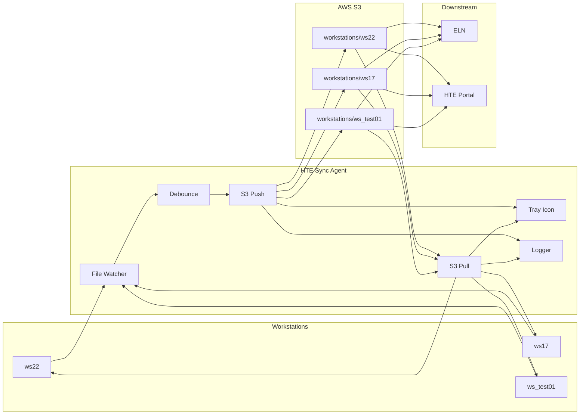

### Module Dependency

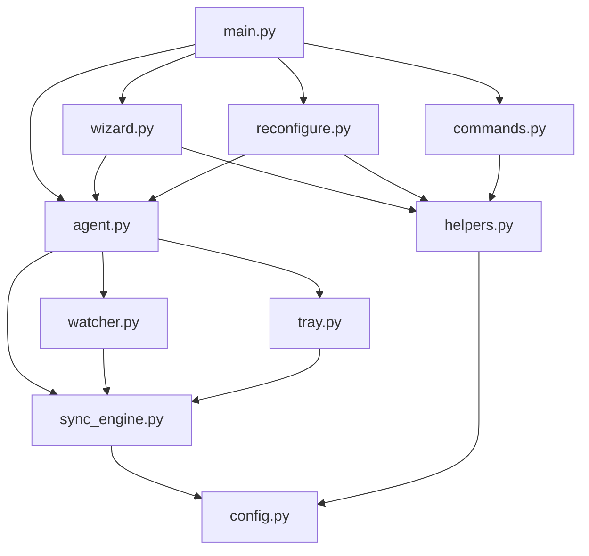

---

## Prerequisites

### Developer Machine (build once)

| Software | Version | Install |
|---|---|---|
| Python | 3.10+ | [python.org](https://python.org) |
| AWS CLI v2 | Latest | [aws.amazon.com/cli](https://aws.amazon.com/cli) |

### Install Python Packages

```batch
pip install rich watchdog pystray pillow plyer boto3 pyinstaller
```

### Verify

```batch
py -c "import rich;     print('rich     OK')"
py -c "import watchdog; print('watchdog OK')"
py -c "import pystray;  print('pystray  OK')"
py -c "import PIL;      print('pillow   OK')"
py -c "import plyer;    print('plyer    OK')"
py -c "import boto3;    print('boto3    OK')"
aws --version
```

### Target Workstations

```
Required  : Windows 10 or 11
Required  : AWS CLI v2
Required  : Admin rights for install.bat only
Not needed: Python
Not needed: pip
```

---

## Build

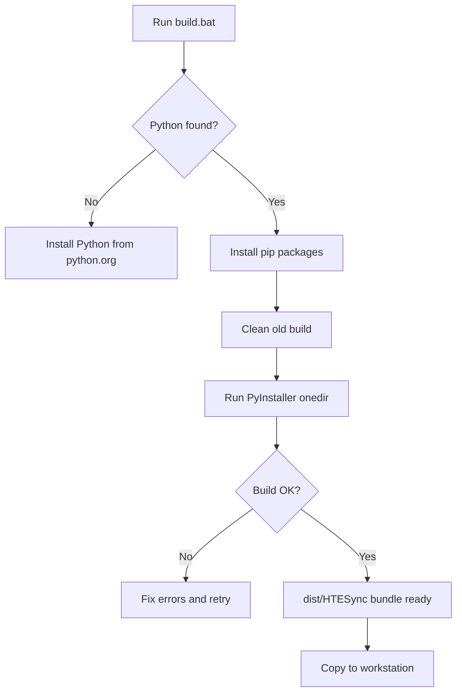

```batch
build.bat
```

Output:
```
dist\
    HTESync\
        HTESync.exe
        _internal\
```

---

## Installation

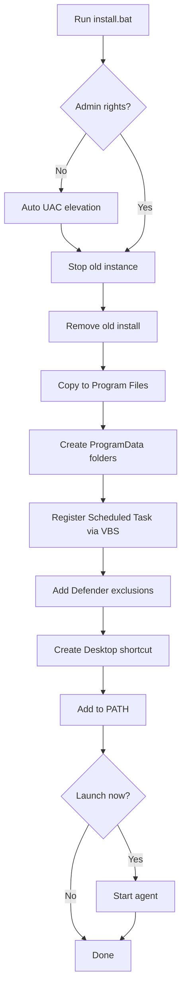

```batch
:: Run as Administrator
install.bat
```

### Simple Deployment (no install.bat)

```batch
copy dist\HTESync.exe C:\ProgramData\HTESync\HTESync.exe
C:\ProgramData\HTESync\HTESync.exe
```

### What install.bat Does

| Step | Action |
|---|---|
| 1 | Auto UAC elevation |
| 2 | Stop old running instance |
| 3 | Remove old Program Files install |
| 4 | Deploy bundle to Program Files |
| 5 | Create ProgramData folders |
| 6 | Register Scheduled Task via VBS launcher |
| 7 | Add Windows Defender exclusions |
| 8 | Create Desktop shortcut |
| 9 | Add to system PATH |
| 10 | Optionally launch agent |

---

## First-Time Setup

Runs automatically when `config.json` does not exist.

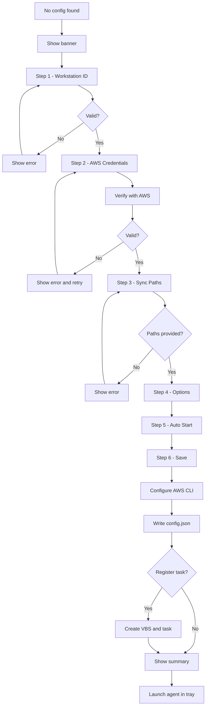

### Setup Fields

| Step | Field | Example | Required |
|---|---|---|---|
| 1 | Workstation ID | ws22 | Yes |
| 2 | AWS Access Key ID | AKIA... | Yes |
| 2 | AWS Secret Key | hidden | Yes |
| 2 | AWS Region | eu-central-1 | Yes |
| 3 | Local Folder | C:\HTE Sync\ws22 | Yes |
| 3 | S3 Bucket | hte-transfer-bucket | Yes |
| 3 | S3 Prefix | workstations/ws22 | Auto |
| 4 | Debounce | 5 seconds | Default 5 |
| 4 | Max Retries | 3 | Default 3 |
| 4 | Delete to S3 | No | Default No |
| 4 | Sync from S3 | Yes | Default Yes |
| 4 | Poll Interval | 30 seconds | Default 30 |
| 4 | Notifications | Yes | Default Yes |
| 4 | Recursive | Yes | Default Yes |
| 4 | Excludes | tmp part | Default set |
| 5 | Auto-Start | Yes | Default Yes |

---

## Agent Runtime

### Startup Sequence

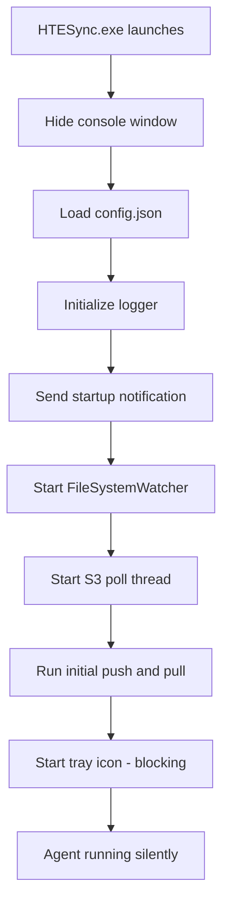

### Watch Loop

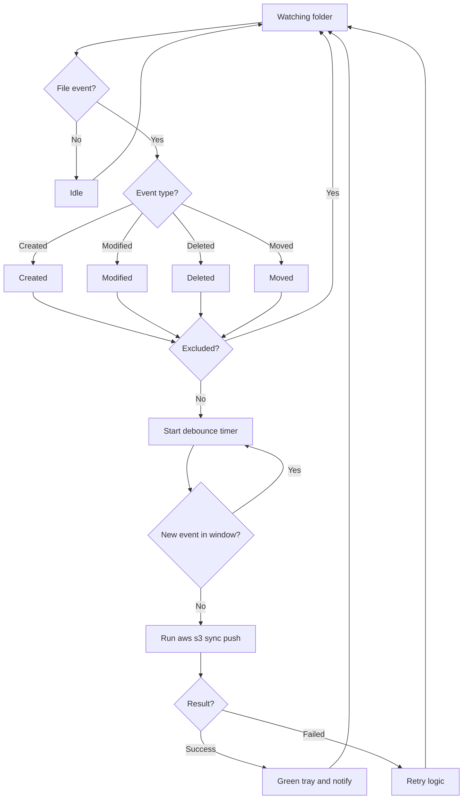

---

## System Tray

### Icon Colors

| Color | Status |
|---|---|
| 🟢 Green | Idle - last sync OK |
| 🟠 Orange | Push or pull in progress |
| 🔴 Red | Failed or auth error |

### Tray Menu

```
Workstation: ws22
Local: C:\HTE Sync\ws22\data
S3: s3://bucket/workstations/ws22/
Status: OK  14:32:01
Pull interval: 30s
─────────────────────
Push to S3 Now
Pull from S3 Now
Show Status
Open Local Folder
View Live Logs
─────────────────────
Reconfigure
Uninstall
─────────────────────
Quit
```

### Tray Menu Flow

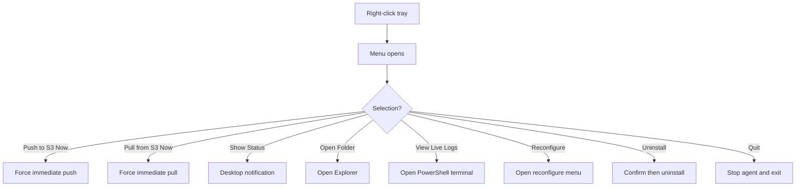

---

## CLI Commands

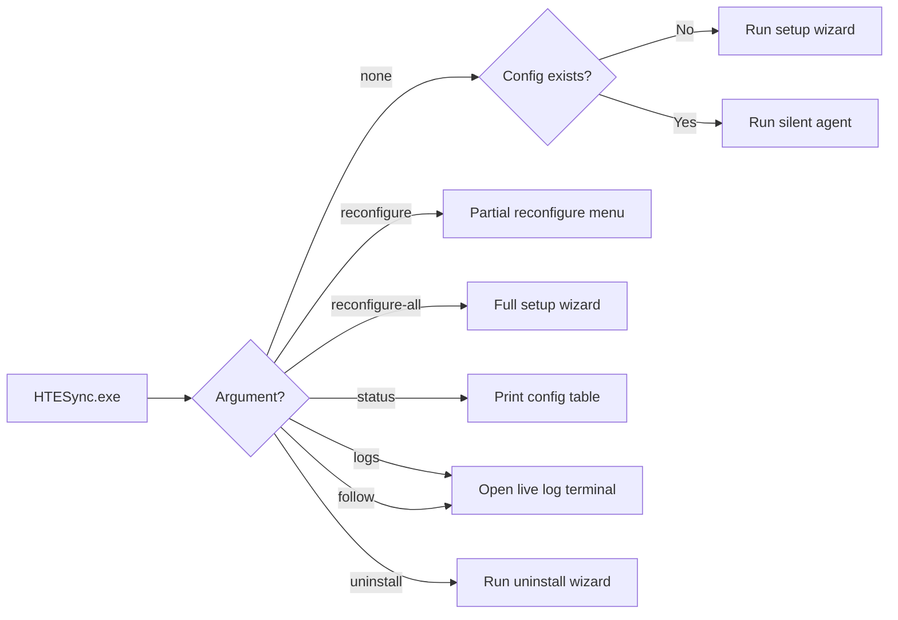

### Reference

| Command | Description |
|---|---|
| `HTESync.exe` | Auto wizard or silent agent |
| `HTESync.exe --reconfigure` | Partial reconfigure menu |
| `HTESync.exe --reconfigure-all` | Full setup wizard from scratch |
| `HTESync.exe --status` | Show current configuration |
| `HTESync.exe --logs` | Open live color log terminal |
| `HTESync.exe --follow` | Open live color log terminal |
| `HTESync.exe --uninstall` | Run full uninstall wizard |

---

## Reconfiguration

Change only the settings you need — no need to redo everything.

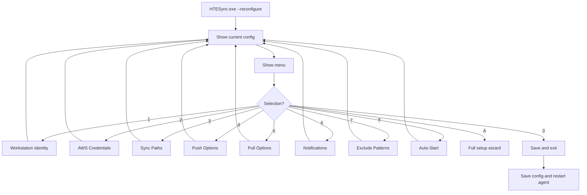

### Menu Options

| Key | Section | What Changes |
|---|---|---|
| 1 | Workstation Identity | workstation_id |
| 2 | AWS Credentials | access key, secret, region |
| 3 | Sync Paths | local_path, s3_bucket, s3_prefix |
| 4 | Push Options | debounce, retries, delete_on_s3, recursive |
| 5 | Pull Options | sync_from_s3, poll_interval |
| 6 | Notifications | notifications on or off |
| 7 | Exclude Patterns | exclude_patterns list |
| 8 | Auto-Start | register or remove task |
| A | All settings | runs full wizard |
| 0 | Save and exit | saves and restarts agent |

---

## Configuration Reference

### Location

```
C:\ProgramData\HTESync\config.json
```

### Full Schema

```json
{
  "workstation_id"   : "ws22",
  "local_path"       : "C:\\HTE Sync\\ws22\\data",
  "s3_bucket"        : "hte-transfer-bucket",
  "s3_prefix"        : "workstations/ws22",
  "region"           : "eu-central-1",
  "debounce_secs"    : 5,
  "max_retries"      : 3,
  "delete_on_s3"     : false,
  "sync_from_s3"     : true,
  "poll_interval"    : 30,
  "notifications"    : true,
  "recursive"        : true,
  "exclude_patterns" : ["*.tmp","*.part","~$*","desktop.ini","Thumbs.db"],
  "log_file"         : "C:\\ProgramData\\HTESync\\logs\\sync_ws22.log"
}
```

### Options

| Key | Type | Default | Description |
|---|---|---|---|
| workstation_id | string | required | Unique machine name |
| local_path | string | required | Folder to watch |
| s3_bucket | string | required | S3 bucket name |
| s3_prefix | string | required | S3 folder path |
| region | string | eu-central-1 | AWS region |
| debounce_secs | int | 5 | Seconds before pushing |
| max_retries | int | 3 | Retry attempts on failure |
| delete_on_s3 | bool | false | Mirror local deletes to S3 |
| sync_from_s3 | bool | true | Enable S3 to local pull |
| poll_interval | int | 30 | Seconds between S3 polls |
| notifications | bool | true | Windows toast alerts |
| recursive | bool | true | Watch subfolders |
| exclude_patterns | list | see above | Files to skip |

---

## Auto Start

### How It Works

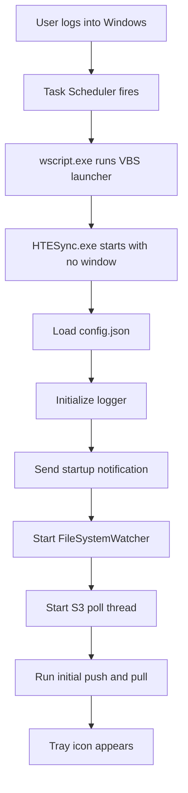

### Task Details

```
Name      : HTESyncAgent_ws22
Trigger   : On user login ONLOGON
Action    : wscript.exe "C:\ProgramData\HTESync\launch_agent.vbs"
Privilege : Highest available
Window    : Hidden - no CMD visible
```

### Task Commands

```batch
schtasks /Query  /TN "HTESyncAgent_ws22" /FO LIST
schtasks /Run    /TN "HTESyncAgent_ws22"
schtasks /Change /TN "HTESyncAgent_ws22" /DISABLE
schtasks /Change /TN "HTESyncAgent_ws22" /ENABLE
schtasks /Delete /TN "HTESyncAgent_ws22" /F
```

---

## Bidirectional Sync

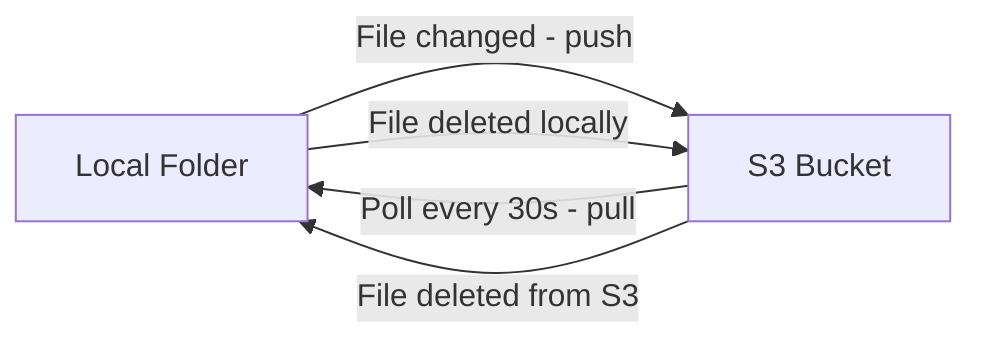

### Sync Direction Summary

| Direction | Trigger | Flag |
|---|---|---|
| Local to S3 | File change (real-time) | aws s3 sync LOCAL S3 |
| S3 to Local | Every poll_interval seconds | aws s3 sync S3 LOCAL --delete |
| Delete to S3 | delete_on_s3 = true | --delete on push |
| Delete to Local | sync_from_s3 = true | --delete on pull (always on) |

### Delete Behavior

| delete_on_s3 | sync_from_s3 | Result |
|---|---|---|
| false | false | No deletions mirrored |
| true | false | Local deletes go to S3 |
| false | true | S3 deletes come to local |
| true | true | Full bidirectional mirror |

### Timeline

```
00:00  Agent starts - initial push and pull
00:30  Poll fires - S3 to local check
01:15  File deleted from S3 bucket
01:30  Poll fires - local file removed
```

---

## Error Handling

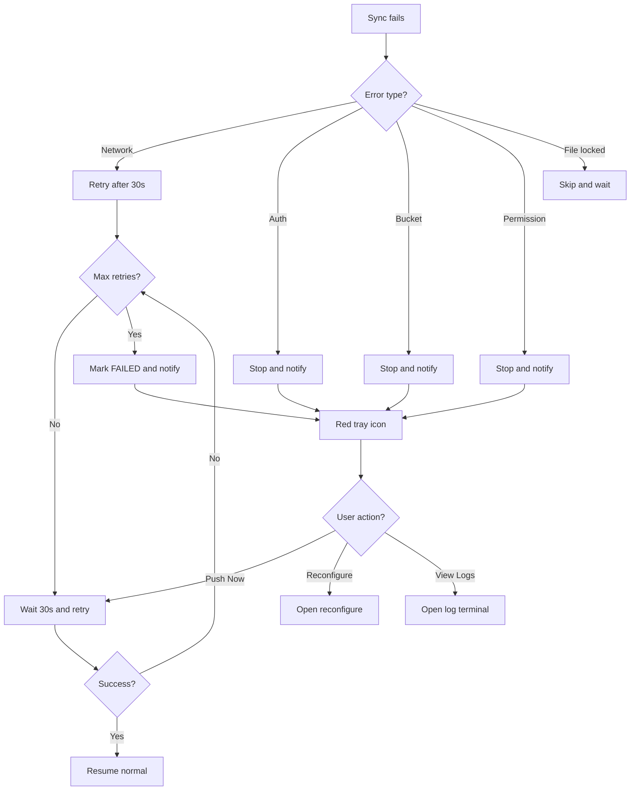

### Error Reference

| Error | Cause | Retries | Fix |
|---|---|---|---|
| Network timeout | No internet | Yes | Wait for connection |
| InvalidClientTokenId | Wrong Access Key | No | Run --reconfigure |
| SignatureDoesNotMatch | Wrong Secret Key | No | Run --reconfigure |
| NoSuchBucket | Wrong bucket name | No | Run --reconfigure |
| AccessDenied | IAM permissions | No | Fix IAM policy |
| File locked | File in use | Next event | Close the file |

---

## Security

### Minimum IAM Policy

```json
{
  "Version": "2012-10-17",
  "Statement": [
    {
      "Effect": "Allow",
      "Action": [
        "s3:PutObject",
        "s3:GetObject",
        "s3:DeleteObject",
        "s3:ListBucket"
      ],
      "Resource": [
        "arn:aws:s3:::hte-transfer-bucket",
        "arn:aws:s3:::hte-transfer-bucket/workstations/*"
      ]
    }
  ]
}
```

### Defender Exclusions Added Automatically

```
Folders  : C:\Program Files\HTESync\
           C:\ProgramData\HTESync\
Process  : HTESync.exe
```

---

## Troubleshooting

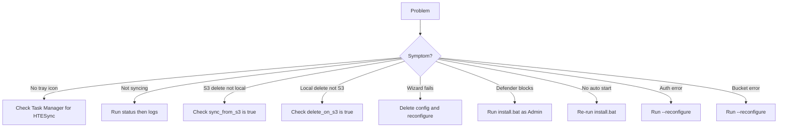

### Diagnostic Commands

```batch
tasklist | findstr HTESync
HTESync.exe --status
HTESync.exe --logs
aws sts get-caller-identity
aws s3 ls s3://your-bucket/
schtasks /Query /TN "HTESyncAgent_ws22" /FO LIST
type C:\ProgramData\HTESync\config.json
```

---

## Uninstall

### From Tray

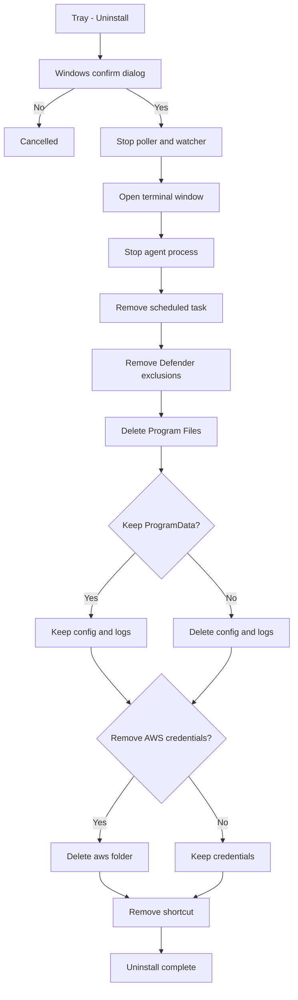

### From CLI

```batch
HTESync.exe --uninstall
```

### Manual Commands

```batch
taskkill /IM HTESync.exe /F
schtasks /Delete /TN "HTESyncAgent_ws22" /F
powershell Remove-MpPreference -ExclusionPath "C:\Program Files\HTESync"
powershell Remove-MpPreference -ExclusionPath "C:\ProgramData\HTESync"
powershell Remove-MpPreference -ExclusionProcess "HTESync.exe"
rmdir /s /q "C:\Program Files\HTESync"
rmdir /s /q "C:\ProgramData\HTESync"
```

---

## Quick Reference

```
PATHS
  App    : C:\Program Files\HTESync\HTESync.exe
  Config : C:\ProgramData\HTESync\config.json
  Logs   : C:\ProgramData\HTESync\logs\
  VBS    : C:\ProgramData\HTESync\launch_agent.vbs

COMMANDS
  HTESync.exe                   Auto wizard or agent
  HTESync.exe --reconfigure     Partial reconfigure menu
  HTESync.exe --reconfigure-all Full setup wizard
  HTESync.exe --status          Show configuration
  HTESync.exe --logs            Live log terminal
  HTESync.exe --uninstall       Uninstall wizard

TRAY COLORS
  Green  = Idle or last sync OK
  Orange = Sync in progress
  Red    = Failed or auth error

SYNC DIRECTION
  Local to S3  = Real-time on file change
  S3 to Local  = Every poll_interval seconds

BUILD AND DEPLOY
  Build   : build.bat on dev machine
  Install : install.bat as Admin on workstation
  Remove  : HTESync.exe --uninstall
```

---

*HTE Sync Agent v3.3 — Clariant HTE Team — 2026*
