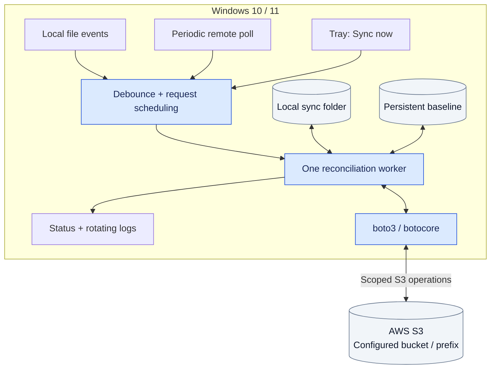
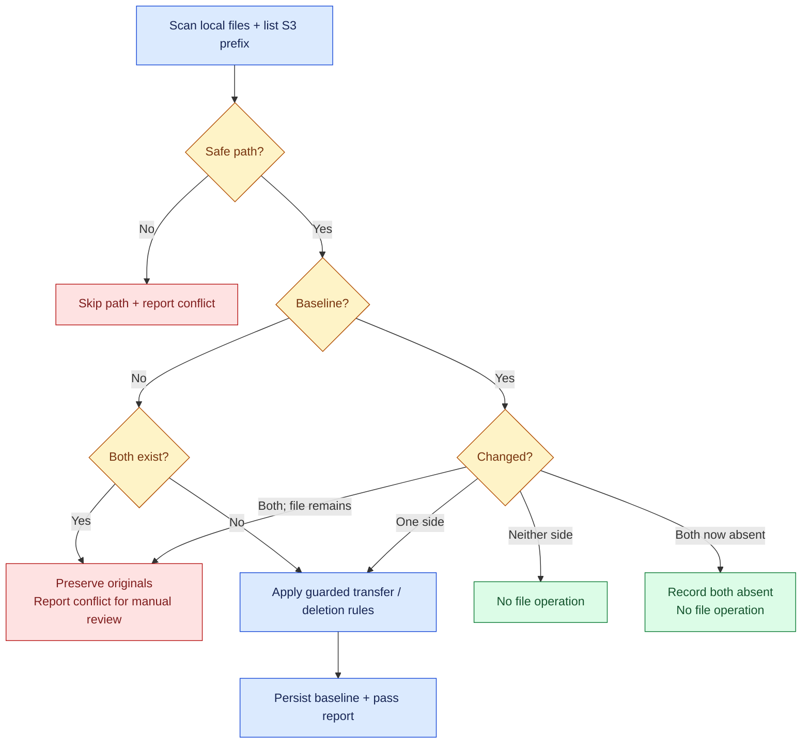
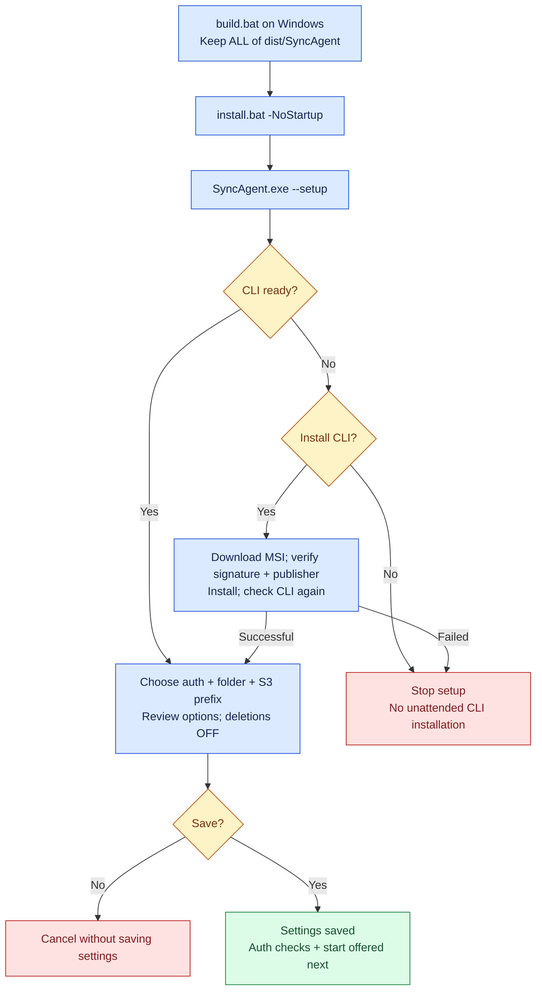
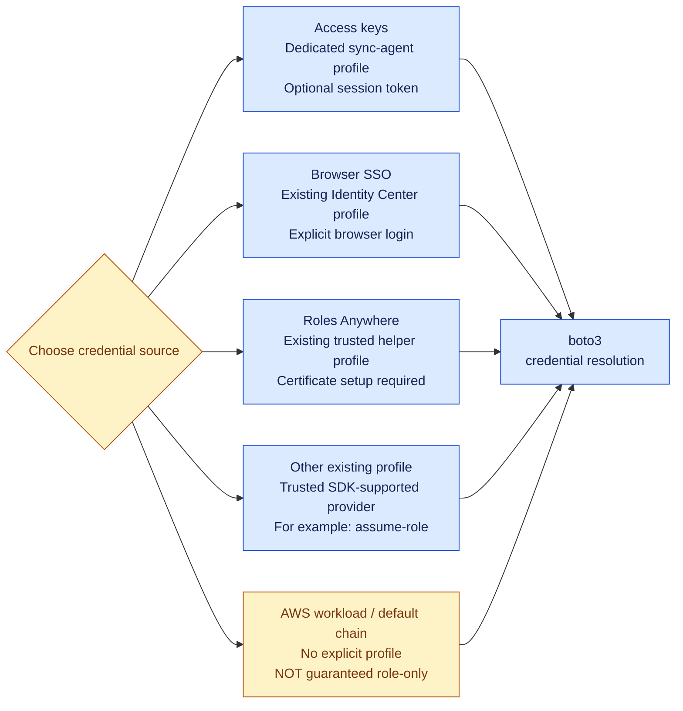
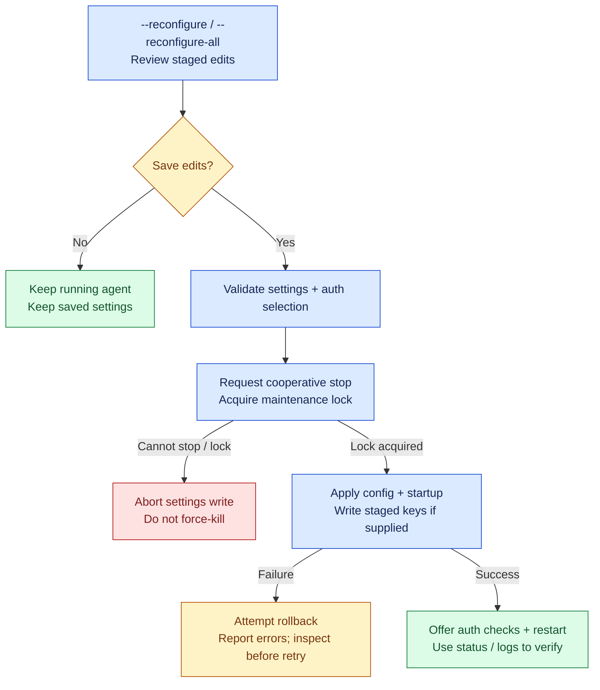
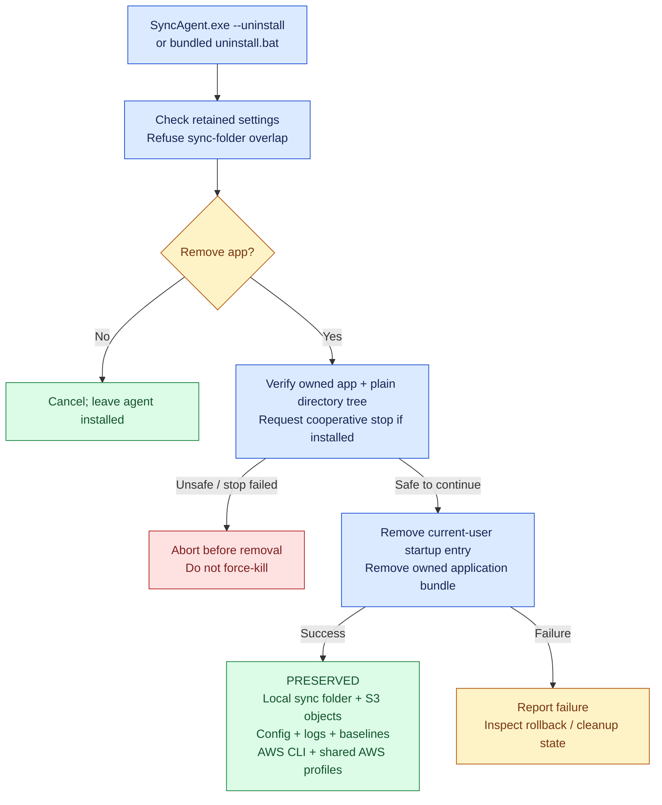

# Sync Agent

Windows 10/11 desktop tray application for conservative file synchronization with an AWS S3 bucket prefix. The executable is `SyncAgent.exe`. It runs as the signed-in user, not as a Windows service.

## How Sync Agent fits together

One Windows tray app, one reconciliation worker, one configured S3 prefix. The arrows below show actual file/state access; the AWS CLI is **not** the transfer engine.



**Reading the diagrams:** arrows show the flow; diamonds are decisions. Blue boxes perform work, green boxes are completed outcomes, amber boxes need a decision/review, and red boxes stop or skip an unsafe action. Labels explain the meaning without relying on color.

**Jump to:** [First installation](#installation-and-first-run) · [Authentication](#choose-an-authentication-method) · [Sync decisions](#how-a-sync-pass-decides) · [Reconfiguration](#reconfiguration-without-interrupting-on-cancel) · [Uninstall](#what-uninstall-removes-and-keeps)

## Safety and validation status

Use a disposable local folder and a non-production S3 prefix for initial Windows testing. This repair has offline regression coverage; a passing Linux test run or PowerShell parse does not establish that native Windows installation, the packaged executable, or live S3 integration works. Native Windows 10 and Windows 11 acceptance testing remains required. No production AWS calls are necessary to run the tests.

- Files present only locally are uploaded, not removed to match S3.
- Local and remote deletion propagation are both disabled by default.
- A persistent baseline records prior file hashes and S3 ETags. Deletions observed with propagation disabled are remembered, preventing an automatic upload/download from resurrecting the deleted side.
- If both sides changed or a path cannot be mapped safely, the application preserves both originals and reports a conflict. It does not automatically merge or create a resolution copy.
- On first synchronization, an existing path on both sides is treated conservatively as a conflict because there is no shared baseline, even if the contents might be identical.
- Downloads use temporary files and recheck local content before atomic replacement. S3 writes use conditional requests. Failed conditions are reported rather than retried as unconditional overwrites.
- One worker serializes synchronization; events arriving during a transfer remain pending. Directory changes also enqueue reconciliation.
- Windows reserved names, traversal, case/Unicode aliases, links and reparse points are rejected. These checks reduce risk but are not an OS sandbox against a malicious process that can concurrently rewrite the same filesystem tree.
- Uploads larger than 5 GiB are refused; conditional multipart uploads are not implemented. Empty directories and metadata/ACL mirroring are not supported.
- Enable S3 bucket versioning and maintain independent backups. Synchronization is not a backup service.

Do not manually delete or edit the baseline to resolve conflicts: removing it changes first-sync/deletion semantics and can resurrect previously deleted data. Stop the agent, preserve copies of both sides, and resolve conflicts deliberately. Changing the local folder, bucket, prefix, profile or non-key authentication method creates a separate baseline identity. Access-key mode retains the prior profile-bound identity for compatibility; switching to a non-key method refuses an existing older identity until migration is reviewed, rather than silently dropping tombstones. Pre-release baselines that lack profile identity require explicit review/migration; the agent refuses to silently discard their tombstones and begin first sync.

### How a sync pass decides

This is a per-path overview, not a timestamp-based winner selection. A baseline is the last recorded local hash / remote ETag pair, including retained deletions.



| Guarded action | What must be true | If the guard fails |
| --- | --- | --- |
| Upload a new/changed local file | Stable local snapshot; conditional S3 write succeeds | Report error; no unconditional overwrite fallback |
| Download a new/changed S3 object | Downloads enabled; no retained-deletion conflict; remote/local checks pass | Skip, report conflict or report error; do not blindly replace local data |
| Propagate a local deletion to S3 | Baseline-confirmed deletion; `delete_on_s3=true`; conditional S3 delete succeeds | Preserve remote object; disabled deletions remain recorded |
| Propagate a remote deletion locally | Baseline-confirmed deletion; downloads enabled; `delete_local=true`; local file still matches | Preserve local file; do not delete a newly edited file |
| Revisit a retained one-sided deletion | No automatic resurrection is allowed by the retained-deletion rule | Report conflict when a transfer would resurrect the absent side |

Both deletion options default to **off**. Download replacement is atomic; conflict handling is not an automatic merge. The chart summarizes path decisions, not every exception/stop branch; eligible baseline updates are saved at the end of the pass.

## Quick install (one file)

`build.bat` also produces **`dist\SyncAgentSetup.exe`**, a single self-contained installer. Copy only that file to the workstation and double-click it (no administrator rights, no Python):

1. It shows the plan (destination, kept settings) and asks once for confirmation.
2. It installs the embedded bundle with the same safe `install.ps1` (staging, ownership/overlap checks, rollback).
3. It configures itself: the guided setup wizard opens automatically on a new install; an upgrade keeps existing settings and offers to restart the agent.

```bat
SyncAgentSetup.exe                         rem interactive install + guided setup
SyncAgentSetup.exe --config office.json    rem install + apply prepared settings
SyncAgentSetup.exe --yes                   rem unattended install (configure later)
SyncAgentSetup.exe --yes --config office.json   rem unattended install + configure + start
SyncAgentSetup.exe --no-startup            rem never register start at login
```

**Prepared settings for many workstations:** put a `SyncAgent.config.json` next to `SyncAgentSetup.exe` (or pass `--config`) and it is applied automatically after installation. See [`SyncAgent.config.example.json`](SyncAgent.config.example.json). `workstation_id` may be omitted; the computer name is used. The file never contains credentials: use an SSO, Roles Anywhere, workload or existing profile, or an already provisioned `sync-agent` profile. Settings are fully validated before the running agent is stopped. With `--yes`, a missing AWS CLI is reported rather than installed unattended. Installed agents accept the same file with `SyncAgent.exe --import-config FILE [--yes]`.

## Start here on Windows

Follow [WINDOWS_SETUP.md](WINDOWS_SETUP.md) for the step-by-step build, installation, authentication and first-test walkthrough. Use [ACCEPTANCE.md](ACCEPTANCE.md) for the packaged Windows tests and live AWS acceptance checklist. Initial testing should leave startup and deletion propagation off.

The repository contains source and build instructions, not a Windows executable built or validated in this Linux repair session.

## Build on Windows

Install a supported 64-bit Python version (Python 3.12 is the Windows CI target), then run:

```bat
build.bat
```

The build creates `.venv-build`, installs `requirements-dev.txt`, runs the complete pytest suite, and packages only `main.py` using PyInstaller. Any failing step aborts the build. `program.bat` forwards to the same build.

Output: `dist\SyncAgent\SyncAgent.exe`, `_internal`, and the lifecycle scripts, plus the one-file installer `dist\SyncAgentSetup.exe` that embeds that complete folder. Distribute either `SyncAgentSetup.exe` alone or the entire `dist\SyncAgent` folder, not just `SyncAgent.exe`. Python is not required on target workstations. This distribution targets 64-bit Windows; Windows ARM64/x86 support has not been established.

## Install and AWS CLI detection

On the target Windows 10/11 machine, run `install.bat` from the full bundle, or from the source directory after building. Run it as the normal user.

```bat
install.bat
```

Default locations:

```text
%LOCALAPPDATA%\Programs\SyncAgent\    application bundle
%LOCALAPPDATA%\SyncAgent\config.json settings (no AWS secret keys)
%LOCALAPPDATA%\SyncAgent\logs\       rotating logs
%LOCALAPPDATA%\SyncAgent\baseline-*.json reconciliation baselines
```

Installation requests confirmation, stages the bundle, checks its diagnostic entry point, requests a cooperative stop of the previous agent, and replaces the application with rollback on failure. It registers current-user startup under `HKCU\Software\Microsoft\Windows\CurrentVersion\Run`. There are no scheduled tasks, Defender exclusions, system PATH changes, force-killed application processes, or automatic removal of older differently named products.

The installer/uninstaller refuse unrecognized existing application folders (ownership requires `SyncAgent.install.json` and the expected executable), configured sync-folder overlap, and unreadable settings that prevent checking overlap. Do not add an ownership marker to an unrelated directory to bypass this protection. Filesystem rollback is attempted even if restoring startup registration fails; reported registry errors may require manual repair. Startup commands exceeding the 260-character Run-key limit are rejected; `-NoStartup` avoids startup registration.

Installer switches:

```bat
install.bat -NoStartup
install.bat -SourceDir "C:\Downloads\SyncAgent"
```

`-Yes` bypasses the installation confirmation; do not use it without reviewing the destination and source. Installation itself does not configure credentials or access S3. Start setup explicitly afterward:

```bat
"%LOCALAPPDATA%\Programs\SyncAgent\SyncAgent.exe" --setup
```

At interactive setup and normal interactive startup, the application probes AWS CLI with a bounded `aws --version` check. If absent, it asks for approval to download and install the official current-user AWS CLI MSI. The bootstrap verifies Authenticode validity and the Amazon publisher, checks MSI exit status, then probes the installed CLI again. Cancelling the download does not silently install anything. Noninteractive/background startup fails clearly if AWS CLI is missing; it never opens an unattended installer. Diagnostics (`--status`, `--logs`, `--stop`, `--help`) do not bootstrap AWS CLI.

The sync engine uses boto3, not opposing `aws s3 sync --delete` commands. AWS CLI remains a checked prerequisite to satisfy the deployment requirement.

### Installation and first run

Recommended first test: keep the entire bundle together, install without startup, and use disposable data. Installation and AWS setup are separate steps.



Declining the final settings save does not undo an AWS CLI installation you approved earlier. Access-key verification can contact STS before saving; SSO login is offered only after saving. Background mode never opens the installer or SSO browser. A verified STS identity still does **not** prove access to the chosen S3 prefix.

## Setup and reconfiguration

The wizard collects workstation ID, authentication method, region, local folder, bucket/prefix and sync options. Authentication choices are:

1. **Access keys** (`auth_method=access_keys`, default for old configurations): new access/secret keys and an optional session token are masked and written only after final confirmation, to the dedicated `sync-agent` profile. Explicit new-key setup removes conflicting provider directives only from that dedicated profile; other AWS profiles and SSO-session sections remain intact.
2. **Browser SSO** (`sso`): select an existing IAM Identity Center profile. The wizard validates its structure without requesting credentials, then offers browser login only after the approved settings save. Provision the organization-managed profile beforehand using `aws configure sso --profile company-sso`. IAM Identity Center must already be enabled and permissioned by your AWS administrator. The application does not provision an organization, permission set or account access.
3. **Roles Anywhere** (`roles_anywhere`): select an existing trusted profile configured with `credential_process` and an administrator-provisioned signing helper, certificate/private-key source, trust anchor, Roles Anywhere profile and IAM role. No certificate, private key, signing helper or AWS infrastructure is provisioned/downloaded by this wizard. A credential process executes a local program when credentials are requested: inspect and trust it first. The application checks profile structure, not certificate authenticity or the helper's publisher.
4. **AWS workload/default credential chain** (`workload_role`): do not explicitly select a profile. boto3 uses its normal provider chain, including EC2/container roles when applicable. This is NOT a role-only security boundary: environment credentials, environment-selected/default profiles and other SDK providers can take precedence. Best used in a deliberately configured AWS workload environment.
5. **Other existing AWS profile** (`profile`): use a trusted preconfigured profile, including assume-role or other SDK-supported providers. Profile validation does not itself establish AWS permissions.

Non-key options do not rewrite shared AWS configuration or credential files. Profile-based modes explicitly select the configured profile; background sync never initiates SSO browser login. SSO login separately updates AWS CLI-managed token caches, and a configured process provider can have its own side effects. Temporary credentials can refresh through the SDK, but an expired SSO login session still needs interactive sign-in again. `--login` performs that explicit browser login; `--check-auth` requests STS identity, reports the account/principal when its fields pass display validation, and can execute a selected credential helper. Neither is proof of S3 authorization.

Local profile validation reads AWS configuration/credentials files without requesting credentials or executing a helper. SSO and Roles Anywhere modes refuse profiles containing competing/static credential providers. Explicit SSO login has a 300-second process timeout; STS identity checks use 5-second connection and 10-second read timeouts with one attempt. SDK timeouts do not bound third-party credential helper execution: a broken or interactive helper can still block credential resolution. Configure and test a trusted noninteractive helper before unattended sync.

Presigned URLs are deliberately not a full-sync authentication mode: they grant selected object operations and do not provide the bucket listing and general conditional operations this engine requires. They would need a separate limited transfer feature.

Credential files are ordinary AWS shared files, not encrypted storage. Protect them with Windows account/file permissions. The setup identity check calls STS using the selected profile; synchronization also requires S3 permissions and may incur AWS charges.

```bat
SyncAgent.exe --reconfigure
SyncAgent.exe --reconfigure-all
```

Partial reconfiguration offers identity, authentication/region, paths and sync/startup options. Cancel leaves the running agent and saved configuration untouched. Saving validates first, requests a cooperative stop, and holds the singleton lock while applying changes. Credentials/config/startup writes are rolled back on failure where possible; errors are reported. Restart is offered after a successful save. An active transfer that cannot stop in time prevents applying changes; do not force-kill it to continue.

### Choose an authentication method

Choose the credential source that is already provisioned for your environment. This is a choice map, not an automatic security ranking or an infrastructure-provisioning wizard.



Local profile validation does not execute a helper or authenticate to AWS. Actual credential resolution and `--check-auth` can execute a configured helper; SSO browser sign-in is explicit. Shared credentials stay outside `config.json`. See the method-specific caveats above before selecting a provider.

### Reconfiguration without interrupting on cancel



Validation or stop failure prevents applying the edits. Rollback is best effort, not a guarantee that every external side effect can be undone. Changing the sync destination or authentication identity can require baseline/migration review; it is not permission to erase the old baseline.

## Commands

Run commands from the installed directory or use the full executable path (the installer does not modify PATH).

```bat
SyncAgent.exe                       rem setup if unconfigured; otherwise run
SyncAgent.exe --setup
SyncAgent.exe --background          rem noninteractive; refuses missing configuration
SyncAgent.exe --status
SyncAgent.exe --login               rem explicit SSO browser sign-in only
SyncAgent.exe --check-auth          rem contacts STS; may execute a profile helper
SyncAgent.exe --logs                rem print recent log tail
SyncAgent.exe --logs --follow
SyncAgent.exe --stop                rem cooperative, token-scoped singleton stop
SyncAgent.exe --reconfigure
SyncAgent.exe --reconfigure-all
SyncAgent.exe --uninstall
SyncAgent.exe --import-config FILE  rem apply prepared settings; add --yes to skip prompts
SyncAgent.exe --version
```

The tray offers Sync now, status, SSO sign-in (when selected), AWS identity check, local folder, logs, reconfiguration, uninstallation and Quit. Maintenance opens a separate console; cancellation does not shut down the agent. Inspect logs for synchronization conflicts and failures; the tray icon is not a detailed health indicator.

## Configuration

Settings are validated on load and saved atomically. Unknown fields, including secret-key fields, are not retained in the validated configuration or shown by `--status`. Example:

```json
{
  "workstation_id": "ws22",
  "local_path": "C:\\Users\\Example\\Documents\\SyncFiles",
  "s3_bucket": "example-sync-bucket",
  "s3_prefix": "workstations/ws22",
  "region": "eu-central-1",
  "auth_method": "access_keys",
  "aws_profile": "sync-agent",
  "debounce_secs": 5,
  "poll_interval": 30,
  "max_retries": 3,
  "transfer_timeout": 60,
  "recursive": true,
  "sync_from_s3": true,
  "delete_on_s3": false,
  "delete_local": false,
  "notifications": true,
  "autostart": false,
  "exclude_patterns": ["*.tmp", "*.part", "~$*", "desktop.ini", "Thumbs.db"]
}
```

`delete_on_s3` permits propagation of a previously baselined local deletion. `delete_local` permits propagation of a previously baselined remote deletion. Neither flag authorizes clearing unrelated first-sync files. Both default to false; enabling either is destructive and should follow backup and disposable-data testing. `sync_from_s3=false` disables remote-to-local updates. The wizard leaves deletion propagation off unless already explicitly enabled in a validated configuration.

The local folder must be absolute and separate from the application/settings directories. Do not use a filesystem root, another application's installation, a junction or a symbolic link. Transfer timeout bounds individual SDK connection/read operations, not the duration of an entire large transfer. A stop timeout reports failure while an in-flight operation may still finish; the singleton remains held through worker shutdown.

## AWS permissions

Use a dedicated least-privilege identity restricted to the configured bucket prefix. Scope `s3:ListBucket` to that prefix with an `s3:prefix` condition; scope `s3:GetObject` and `s3:PutObject` to the corresponding object ARN. Grant `s3:DeleteObject` only if remote deletion propagation is deliberately enabled. KMS-encrypted buckets can require additional key permissions. Avoid bucket-wide wildcard write/delete grants. Review IAM and bucket policies with your AWS administrator rather than copying a broad example policy.

Official references:

- AWS CLI installation: https://docs.aws.amazon.com/cli/latest/userguide/getting-started-install.html
- IAM Identity Center provider: https://docs.aws.amazon.com/sdkref/latest/guide/feature-sso-credentials.html
- Roles Anywhere profiles: https://docs.aws.amazon.com/sdkref/latest/guide/access-rolesanywhere.html
- boto3 credential chain: https://docs.aws.amazon.com/boto3/latest/guide/credentials.html
- S3 conditional writes: https://docs.aws.amazon.com/AmazonS3/latest/userguide/conditional-writes.html
- S3 conditional deletes: https://docs.aws.amazon.com/AmazonS3/latest/userguide/conditional-deletes.html

## Uninstall

```bat
SyncAgent.exe --uninstall
```

Alternatively, run the bundled `uninstall.bat`. Confirmation is required unless `-Yes` was explicitly supplied. The uninstaller requests a safe stop and removes the current user's application/startup registration. It preserves the sync folder, S3 objects, configuration, logs, baselines, AWS CLI and all shared AWS profiles. It does not uninstall legacy applications or remove their tasks/exclusions. Retained credentials and data must be reviewed and removed separately if appropriate.

### What uninstall removes and keeps



Scope/ownership checks fail closed; invalid settings can stop uninstall before confirmation. App/startup rollback is attempted if staging or startup removal fails; a later cleanup failure can still leave staged files requiring review. Preserved AWS credentials are **not revoked** by uninstalling the application.

## Development and validation

```text
python -m pip install -r requirements-dev.txt
python -m pytest tests -q
python main.py --help
python main.py --status
```

Tests use temporary directories, fake stores and mocked download/MSI boundaries; never put real credentials in tests. Bootstrap and lifecycle behavior can also be tested with portable PowerShell using `SYNC_AGENT_TEST_PWSH=/absolute/path/to/pwsh`; those runs mock process, network and registry boundaries and do not establish native Windows behavior. Native Windows locks, signatures, MSI execution and frozen GUI behavior still require Windows acceptance tests. The GitHub Actions Windows workflow parses PowerShell, runs the offline suite, builds the bundle and `SyncAgentSetup.exe`, smoke-tests packaged `--help` for both, and opts into the native packaged install/upgrade/uninstall and junction tests on its disposable Windows runner. A workflow definition is not evidence that the workflow has run successfully. The workflow is manual-only (`workflow_dispatch`) to avoid automatic runner usage: open the repository's Actions tab, select **Windows distribution**, then **Run workflow** when you are ready to consume Actions minutes. Uploading or pushing alone does not trigger it. Windows runner/server testing also does not replace separate Windows 10 and Windows 11 desktop acceptance.

Before release, test the full bundle on separate clean Windows 10 and Windows 11 installations: missing/present AWS CLI, declined setup, existing-profile preservation, paths with spaces/non-ASCII, login startup, two-instance rejection, stop during transfer, cancelled reconfiguration/uninstall, successful upgrade and failure rollback, retained user data, and uninstall. Then use disposable AWS objects to verify conflicts, deletion defaults, conditional-write failure and restart behavior before any valuable-data deployment.

### Testing the one-file installer

Get `SyncAgentSetup.exe` either by running `build.bat` on Windows, or from the **SyncAgentSetup-windows** artifact of a manual **Windows distribution** workflow run (`gh workflow run windows.yml --ref <branch>`).

Test on a disposable machine: the installer writes to `%LOCALAPPDATA%` and the current-user Run key. **Windows Sandbox** (Windows 10/11 Pro: *Turn Windows features on or off → Windows Sandbox*) is reset each time it closes; a VM snapshot also works. Copy only `SyncAgentSetup.exe` into it.

| Test | How | Expected |
|---|---|---|
| Fresh install | Double-click `SyncAgentSetup.exe` | Plan shown → confirm → installed to `%LOCALAPPDATA%\Programs\SyncAgent` → setup wizard opens |
| Cancel | Run again and answer **n** | "Installation cancelled; no changes made." |
| Wizard without AWS changes | Complete the wizard, answer **n** at "Save these settings?" | Review table shown; nothing saved |
| Status | `"%LOCALAPPDATA%\Programs\SyncAgent\SyncAgent.exe" --status` | Agent state, last pass and settings table |
| Upgrade | Run `SyncAgentSetup.exe` again after saving settings | "Upgrade existing installation"; settings kept; start offered |
| Prepared settings | Place an edited copy of `SyncAgent.config.example.json`, renamed `SyncAgent.config.json`, beside the installer and run it | Settings table shown and applied without the wizard |
| Unattended | `SyncAgentSetup.exe --yes --config SyncAgent.config.json` | No prompts; installs, applies settings and starts the agent |
| Invalid settings | Use a file with `"s3_bucket": "s3://bad"` | Rejected before the running agent is stopped |
| Uninstall | `SyncAgent.exe --uninstall` | Application removed; `%LOCALAPPDATA%\SyncAgent` and synced files kept |

Any test that actually synchronizes must use an empty local folder and a disposable S3 bucket/prefix, with both deletion options left **off**.
