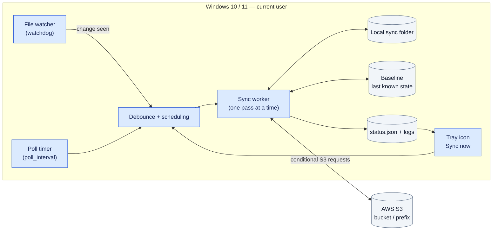
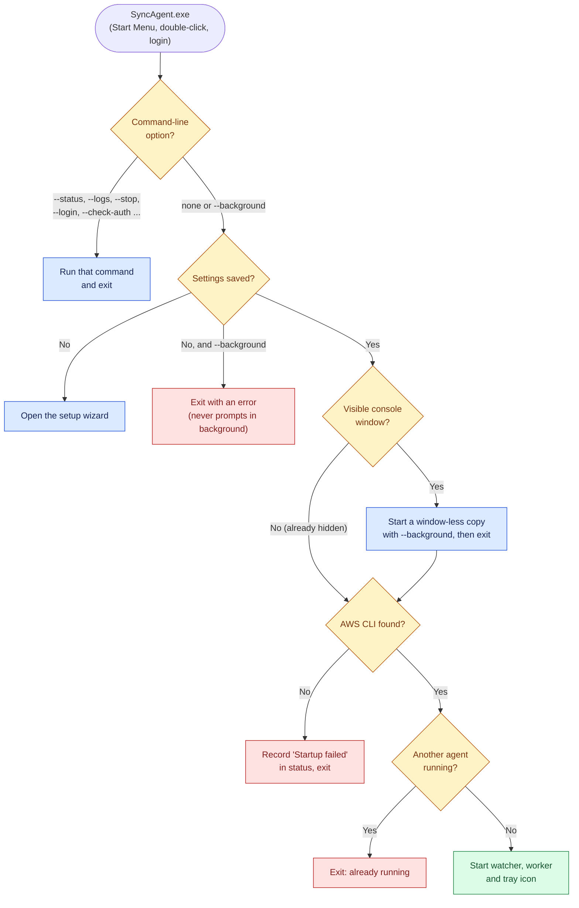
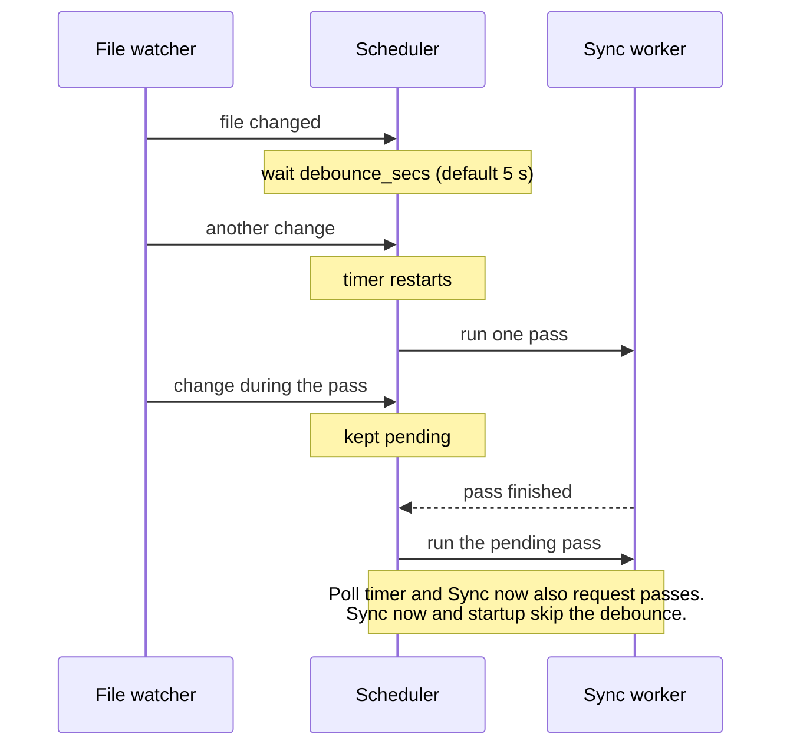
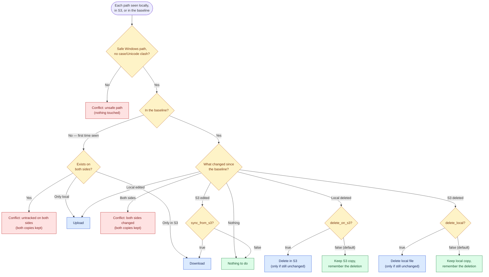
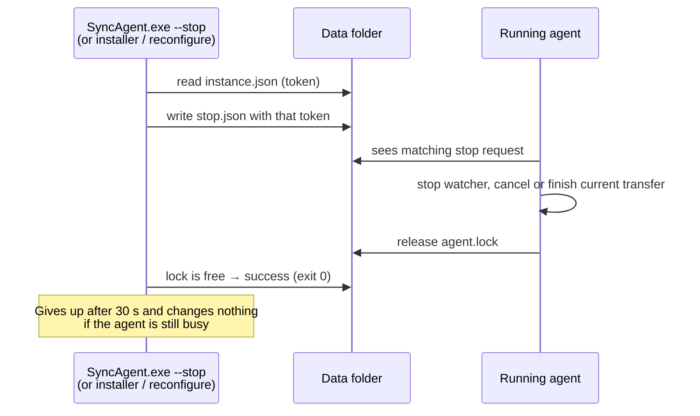
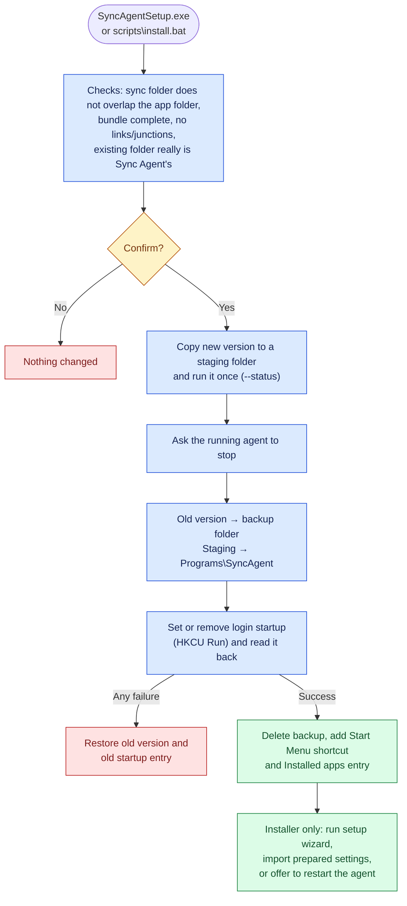

# How Sync Agent works

This page explains what happens inside Sync Agent: which processes run, how a sync pass decides what to do with each file, and what the installer changes on the computer. For day-to-day use, the [README](../README.md) is enough.

- [Components](#components)
- [What happens when you start Sync Agent](#what-happens-when-you-start-sync-agent)
- [The sync worker](#the-sync-worker)
- [How a sync pass decides](#how-a-sync-pass-decides)
- [Safety guarantees](#safety-guarantees)
- [Stopping, upgrading and single-instance protection](#stopping-upgrading-and-single-instance-protection)
- [What the installer and uninstaller change](#what-the-installer-and-uninstaller-change)
- [Files on disk](#files-on-disk)
- [Source code map](#source-code-map)

## Components

Sync Agent is one Windows program, `SyncAgent.exe`, running as the signed-in user (not as a Windows service). While it runs it has three moving parts: a **file watcher**, a **single sync worker** and the **tray icon**.

| Part | Role |
| --- | --- |
| File watcher | Notices local creations, edits, moves and deletions and asks for a sync. It never transfers anything itself. |
| Poll timer | Asks for a sync every `poll_interval` seconds, so changes made in S3 are picked up. |
| Sync worker | The only component that reads S3, transfers files or updates the baseline. Passes never overlap. |
| Baseline | A JSON file recording, for each path, the local content hash and S3 ETag after the last successful sync. It is what lets Sync Agent tell "new" from "deleted" from "changed on both sides". |
| Tray icon | Menu for everyday actions; shows a coloured dot while syncing (amber) or after problems (red). |

The AWS CLI is a checked prerequisite (for sign-in and credential checks), but **file transfers use boto3 directly**, never `aws s3 sync`.

## What happens when you start Sync Agent

The same `SyncAgent.exe` handles setup, the tray agent and every maintenance command. With no options it decides by itself:

The "window-less copy" step is why Sync Agent never leaves a console window open, even at Windows login or when Windows Terminal is the default terminal. If the background copy cannot start (missing AWS CLI, unknown AWS profile, invalid settings), the reason appears as **Startup failed** in `SyncAgent.exe --status`.

## The sync worker

Requests from the watcher, the poll timer and **Sync now** are merged, so a burst of file changes produces one pass, not hundreds.

Each pass:

1. **Scans the local folder** and fingerprints every included file with SHA-256. Files whose size, modification time and file ID are unchanged reuse the previous hash; files modified in the last few seconds are always re-read.
2. **Lists the S3 prefix** (paginated `ListObjectsV2`).
3. **Rejects unsafe paths** on either side: Windows reserved names (`CON`, `NUL`, `COM1` …), `..`, characters invalid on Windows, trailing dots/spaces, links and reparse points, and names that differ only by case or Unicode form.
4. **Decides each path** (next section) and performs the transfer or deletion.
5. **Saves the baseline** and writes `status.json` (the source of `--status` and the tray dot).

## How a sync pass decides

Decisions never compare timestamps to pick a winner. They compare each side with the **baseline**: what both sides looked like after the last successful sync.

Things worth knowing:

- **First sync is cautious.** A file that exists on both sides before there is any baseline is reported as a conflict, even if the bytes are identical. Start with one side empty.
- **Deletions are not propagated by default.** With both deletion settings off, a deletion on one side is remembered (a "tombstone") and the other copy stays. Sync Agent will then refuse to copy that file back over the deletion and reports *"deletion retained; manual resolution required"*.
- **Conflicts are never merged or overwritten.** Both copies stay as they are; the path is listed in `--status` and the logs, and the tray shows a red dot. Resolve by keeping the version you want on one side (and removing or renaming the other), and the next pass continues.
- **Excluded files** (`exclude_patterns`) and Sync Agent's own temporary files (`.sync-agent-*`) are ignored on both sides.

## Safety guarantees

| Operation | What protects it | If the protection trips |
| --- | --- | --- |
| Upload | The file is copied to a private snapshot and re-hashed first; S3 `PutObject` uses `If-None-Match: *` (new) or `If-Match: <ETag>` (update). | Reported as an error; never retried as an unconditional overwrite. |
| Download | Written to a temporary file, local file re-checked, then swapped in atomically. `GetObject` uses `If-Match: <ETag>`. | Error or conflict; the local file is not replaced. |
| Delete in S3 | Only with `delete_on_s3`, only for a baseline-confirmed local deletion, using `DeleteObject` with `If-Match`. | Object kept; error reported. |
| Delete locally | Only with `delete_local`, only if the local file still matches the baseline hash. | File kept; error reported. |
| Large files | Single conditional `PutObject`, so uploads larger than 5 GiB are refused. Downloads of any size are allowed; `transfer_timeout` limits stalls, not total duration. | Error reported for that file. |
| Error messages | Only exception types are logged for transfer errors, because credential helpers can put secrets in messages. | — |

Enable **S3 bucket versioning** and keep independent backups. A sync tool is not a backup.

## Stopping, upgrading and single-instance protection

Only one agent can run per Windows user. The running agent holds an OS file lock (`agent.lock`) and publishes a random token (`instance.json`). Stopping it never kills a process:

Reconfiguration, upgrade and uninstall all use this stop and refuse to continue if it times out.

## What the installer and uninstaller change

Everything is per-user: no administrator rights, no services, no scheduled tasks, no system PATH changes.

The uninstaller asks for confirmation, stops the agent, then removes the application folder, the login startup entry, the Start Menu shortcut and the Installed apps entry. It **keeps** the sync folder, everything in S3, settings, logs, baselines, the AWS CLI and all AWS profiles and credentials.

## Files on disk

| Location | Contents | Removed by uninstall? |
| --- | --- | --- |
| `%LOCALAPPDATA%\Programs\SyncAgent\` | Application (`SyncAgent.exe`, `_internal\`, lifecycle scripts, `SyncAgent.install.json` ownership marker) | Yes |
| `%LOCALAPPDATA%\SyncAgent\config.json` | Settings (never credentials) | No |
| `%LOCALAPPDATA%\SyncAgent\logs\sync_<workstation>.log` | Log, rotated at 5 MB, 3 old files kept | No |
| `%LOCALAPPDATA%\SyncAgent\baseline-<id>.json` | Baseline for one folder/bucket/prefix/identity combination | No |
| `%LOCALAPPDATA%\SyncAgent\status.json` | Result of the last pass, shown by `--status` | No |
| `%LOCALAPPDATA%\SyncAgent\agent.lock`, `instance.json`, `stop.json` | Single-instance lock and stop requests | No |
| `%APPDATA%\Microsoft\Windows\Start Menu\Programs\Sync Agent.lnk` | Start Menu shortcut | Yes |
| `HKCU\Software\Microsoft\Windows\CurrentVersion\Run` → `SyncAgent` | Start at login (only if enabled) | Yes |
| `HKCU\Software\Microsoft\Windows\CurrentVersion\Uninstall\SyncAgent` | Installed apps entry | Yes |
| `%USERPROFILE%\.aws\config`, `credentials` | AWS profiles (access-key mode writes only the `sync-agent` profile) | No |

Do not delete or edit baseline files to get rid of a conflict: that changes first-sync and deletion behaviour and can bring deleted files back.

## Source code map

| File | Responsibility |
| --- | --- |
| [`src/main.py`](../src/main.py) | Command-line entry point and the start-up decision above |
| [`src/agent.py`](../src/agent.py) | Starts and stops the watcher, worker and tray; status reporting |
| [`src/sync_engine.py`](../src/sync_engine.py) | Scheduling, scanning, per-file decisions, baseline |
| [`src/storage.py`](../src/storage.py) | Conditional S3 list/get/put/delete |
| [`src/watchers.py`](../src/watchers.py) | File-system events → sync requests |
| [`src/runtime.py`](../src/runtime.py) | Single-instance lock and cooperative stop |
| [`src/config.py`](../src/config.py) | Settings validation, paths, startup/shortcut registration |
| [`src/authentication.py`](../src/authentication.py) | AWS profile checks, SSO login, identity check |
| [`src/aws_cli.py`](../src/aws_cli.py) | Finding (and, with consent, installing) the AWS CLI |
| [`src/wizard.py`](../src/wizard.py), [`src/reconfigure.py`](../src/reconfigure.py), [`src/helpers.py`](../src/helpers.py) | Setup and reconfiguration console UI |
| [`src/tray.py`](../src/tray.py), [`src/icons.py`](../src/icons.py) | Tray menu, status dot and the application icon |
| [`src/ui.py`](../src/ui.py) | Console presentation (colours, tables, prompts) |
| [`src/commands.py`](../src/commands.py) | `--status`, `--logs`, `--stop`, `--uninstall` |
| [`src/installer.py`](../src/installer.py) | `SyncAgentSetup.exe` |
| [`scripts/`](../scripts) | `install.ps1`, `uninstall.ps1`, `ensure_aws_cli.ps1` and their `.bat` launchers |
