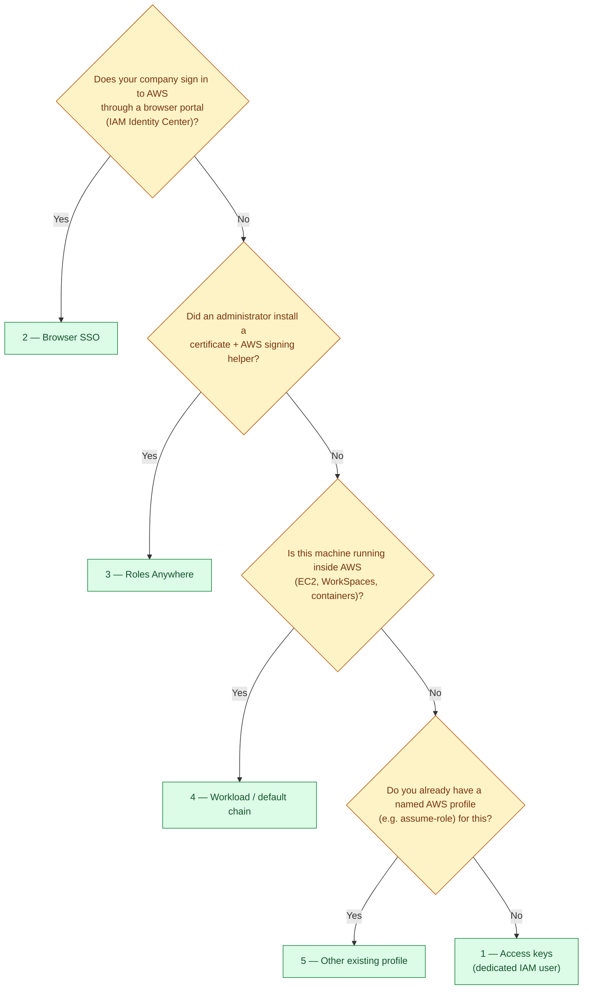

# Signing in to AWS

Sync Agent needs AWS credentials that can list, read and write objects under one S3 prefix. It supports five ways to obtain them. Pick the one your organization already uses; Sync Agent does not create AWS accounts, roles, SSO permission sets or certificates.

- [Choosing a method](#choosing-a-method)
- [1. Access keys](#1-access-keys)
- [2. Browser SSO (IAM Identity Center)](#2-browser-sso-iam-identity-center)
- [3. Roles Anywhere](#3-roles-anywhere)
- [4. Workload / default credential chain](#4-workload--default-credential-chain)
- [5. Other existing AWS profile](#5-other-existing-aws-profile)
- [Minimum AWS permissions](#minimum-aws-permissions)
- [Checking sign-in](#checking-sign-in)

## Choosing a method



| # | Method (`auth_method`) | Credentials come from | Expires? | Setup effort |
| --- | --- | --- | --- | --- |
| 1 | Access keys (`access_keys`) | Keys you type into the wizard, saved to the `sync-agent` profile | Only if you rotate them | Lowest |
| 2 | Browser SSO (`sso`) | Your company sign-in page | Yes: sign in again from the tray when asked | Low if SSO exists |
| 3 | Roles Anywhere (`roles_anywhere`) | A certificate and AWS signing helper | Refreshed automatically | Administrator |
| 4 | Workload chain (`workload_role`) | Environment, default profile or EC2/container role | Refreshed automatically | AWS-hosted only |
| 5 | Other profile (`profile`) | Any profile already in `.aws\config` | Depends on the profile | Varies |

All methods except 1 leave your AWS files untouched. Background sync **never** opens a browser: when an SSO session expires, the tray menu's **Sign in (SSO)** item, or `SyncAgent.exe --login`, signs in again.

## 1. Access keys

Best for a single computer or a small office without SSO.

1. In the AWS console, create an IAM user for Sync Agent and attach the [minimum policy](#minimum-aws-permissions).
2. Create an access key for it (**Security credentials → Create access key → Application running outside AWS**).
3. In the wizard choose **1 — Access keys** and paste the access key ID and secret. The secret is hidden while you type. Leave the session token empty unless you were given temporary credentials.

The keys are checked against AWS straight away; if they are rejected you can re-enter them. They are written only after you confirm the final review, and only to the dedicated `sync-agent` profile in `%USERPROFILE%\.aws\credentials`. Other profiles are left untouched. That file is not encrypted: protect your Windows account, and prefer SSO when available.

## 2. Browser SSO (IAM Identity Center)

1. Your administrator gives you access to an account and role that can use the bucket.
2. Once, in a terminal, create the profile (the AWS CLI is installed by Sync Agent's setup if missing):

   ```bat
   aws configure sso --profile company-sso
   ```

3. In the wizard choose **2 — Browser SSO** and enter `company-sso`. The wizard lists the profiles it finds and lets you fix a typo.
4. After you save, accept *"Sign in … in your browser now?"*.

Sessions last as long as your organization allows (often 8–12 hours). When it expires, syncing stops with errors and the tray shows a red dot: use **Sign in (SSO)** in the tray menu.

## 3. Roles Anywhere

For organizations that issue certificates to computers. Your administrator provisions the trust anchor, the Roles Anywhere profile and IAM role, the certificate and private key, the `aws_signing_helper` program, and an AWS profile such as:

```ini
[profile company-certificate]
credential_process = "C:\Program Files\AWS\aws_signing_helper.exe" credential-process --certificate ... --private-key ... --trust-anchor-arn ... --profile-arn ... --role-arn ...
```

Choose **3 — Roles Anywhere** and enter the profile name. Sync Agent checks only the profile's structure; it runs the configured helper when credentials are needed. Only use helpers you trust.

## 4. Workload / default credential chain

No profile is selected. boto3 uses its normal search order: environment variables, the default profile, then EC2 or container roles. This is meant for Sync Agent running inside AWS (for example on an EC2 instance or WorkSpace with an instance role). It is **not** a guarantee that only the role is used: environment variables or a default profile take precedence. Check which identity is used with `--check-auth`.

## 5. Other existing AWS profile

Any profile that boto3 understands, for example one using `role_arn` + `source_profile` to assume a role. Choose **5** and enter its name. Profiles can run local programs (`credential_process`) to obtain credentials; select only profiles you trust.

## Minimum AWS permissions

Give Sync Agent an identity limited to its prefix. Replace the bucket name and prefix:

```json
{
  "Version": "2012-10-17",
  "Statement": [
    {
      "Sid": "ListOnlyThePrefix",
      "Effect": "Allow",
      "Action": "s3:ListBucket",
      "Resource": "arn:aws:s3:::example-company-sync",
      "Condition": { "StringLike": { "s3:prefix": ["workstations/OFFICE-PC-07/*"] } }
    },
    {
      "Sid": "ReadWriteObjectsUnderThePrefix",
      "Effect": "Allow",
      "Action": ["s3:GetObject", "s3:PutObject"],
      "Resource": "arn:aws:s3:::example-company-sync/workstations/OFFICE-PC-07/*"
    }
  ]
}
```

- Add `"s3:DeleteObject"` to the second statement **only** if you enable `delete_on_s3`.
- Buckets encrypted with a customer-managed KMS key also need `kms:Decrypt` and `kms:GenerateDataKey` on that key.
- Several computers can share one policy by using a wider prefix (`workstations/*`), at the cost of each being able to read the others' files.
- Turn on **bucket versioning** so an overwritten or deleted object can be recovered.

## Checking sign-in

| Command / tray item | What it does | Proves S3 access? |
| --- | --- | --- |
| Setup wizard key check | Calls AWS STS with the typed keys before saving | No |
| `SyncAgent.exe --check-auth` / tray **Check AWS identity** | Calls STS with the configured method; shows account and role/user | No |
| `SyncAgent.exe --login` / tray **Sign in (SSO)** | Opens the SSO sign-in page | No |
| A successful sync pass (`--status` shows **IDLE**, no errors) | Lists, reads and writes the prefix | Yes |

If identity checks succeed but `--status` lists errors such as `ClientError` for every file, the identity works but the S3 permissions above are probably missing or too narrow. Sync Agent shows only error types, never AWS messages, because those can contain credential details.
