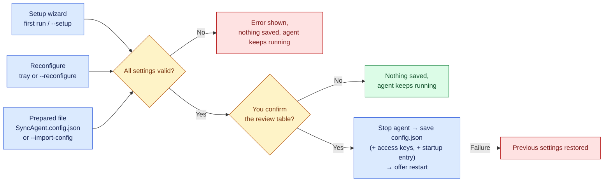
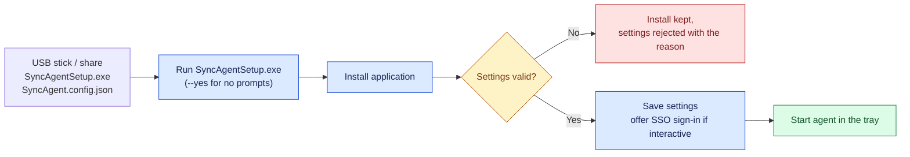

# Configuration reference

Sync Agent keeps its settings in one JSON file per Windows user:

```text
%LOCALAPPDATA%\SyncAgent\config.json
```

You normally never edit it by hand. The setup wizard writes it, and **Reconfigure** (tray menu, or `SyncAgent.exe --reconfigure`) changes it. Every setting is validated before anything is saved, and the file **never contains passwords or AWS keys**.

- [Ways to change settings](#ways-to-change-settings)
- [All settings](#all-settings)
- [Examples](#examples)
- [Prepared settings for many computers](#prepared-settings-for-many-computers)
- [Changing settings safely](#changing-settings-safely)

## Ways to change settings



**Reconfigure** opens a menu so you can change one group of settings without re-entering everything:

| Key | Group | Settings |
| --- | --- | --- |
| `1` | Identity | `workstation_id` |
| `2` | Authentication | `region`, `auth_method`, `aws_profile` (and new access keys) |
| `3` | Paths | `local_path`, `s3_bucket`, `s3_prefix` |
| `4` | Sync options | timers, download/deletion switches, exclusions, `autostart` |
| `a` | All | walk through every step |
| `s` | Save | review and apply |
| `q` | Cancel | leave everything unchanged |

## All settings

Required settings have no default and must be set by the wizard or the prepared file. Everything else can be left out.

### Identity and location

| Setting | Default | Allowed values | What it does |
| --- | --- | --- | --- |
| `workstation_id` | computer name | 1–64 letters, digits, `_` or `-` | Names this computer. It is used in the log file name and in the wizard's suggested S3 prefix (`workstations/<workstation_id>`). Prepared files may omit it; the computer name is used. |
| `local_path` | wizard suggests `%USERPROFILE%\Sync Agent Data` | Absolute folder path with a drive letter or `\\server\share` | The folder kept in sync. It is created if missing. It must not be a file, a symbolic link or junction (or inside one), and must not overlap Sync Agent's own folders. So not `C:\`, not your user folder itself, nothing under `AppData\Local\SyncAgent` or `AppData\Local\Programs\SyncAgent`. Environment variables such as `%USERPROFILE%` are **not** expanded. |
| `s3_bucket` | **required** | Valid S3 bucket name: 3–63 lowercase letters, digits, `.` or `-`; not an IP address | The bucket to sync with. It must already exist. Enter the name only; the wizard strips a leading `s3://`. |
| `s3_prefix` | wizard suggests `workstations/<workstation_id>` | Non-empty; `/` between parts; no leading or trailing `/`, no `\`, no empty, `.` or `..` parts | The "folder" inside the bucket. Only objects under `<prefix>/` are listed, downloaded, uploaded or deleted. |
| `region` | `eu-central-1` | AWS region code such as `us-east-1` | Region of the bucket and of the AWS API calls. |

### Sign-in

| Setting | Default | Allowed values | What it does |
| --- | --- | --- | --- |
| `auth_method` | `access_keys` | `access_keys`, `sso`, `roles_anywhere`, `profile`, `workload_role` | How AWS credentials are obtained. See [authentication.md](authentication.md). |
| `aws_profile` | `sync-agent` | 1–128 letters, digits or `_ . @ + -`. Must be `sync-agent` with `access_keys`, and must be omitted or `null` with `workload_role` | The AWS profile (in `%USERPROFILE%\.aws\config` / `credentials`) Sync Agent signs in with. |

### Sync behaviour

| Setting | Default | Allowed values | What it does |
| --- | --- | --- | --- |
| `sync_from_s3` | `true` | `true` / `false` | Download new and changed files from S3. With `false`, Sync Agent only uploads (one-way backup style). |
| `recursive` | `true` | `true` / `false` | Include subfolders. With `false`, only files directly in `local_path` (and objects directly under the prefix) are synced. |
| `delete_on_s3` | `false` | `true` / `false` | **Destructive.** When a file that was previously synced is deleted locally, delete it in S3 too. With `false`, the S3 copy is kept and the deletion is remembered. |
| `delete_local` | `false` | `true` / `false` | **Destructive.** When a previously synced object is deleted in S3, delete the local file too (only if it was not edited since). With `false`, the local copy is kept. |
| `exclude_patterns` | `["*.tmp", "*.part", "~$*", "desktop.ini", "Thumbs.db"]` | Up to 100 patterns, each up to 256 characters | Files to ignore on both sides. Patterns use `*`, `?` and `[abc]`, and are matched against the file name and against the path relative to the sync folder (with `/`), e.g. `*.bak`, `cache/*`. Matching is **case-sensitive**: add `*.TMP` too if needed. Sync Agent's own `.sync-agent-*` temporary files are always ignored. |

Leave both deletion settings off until you have tested with disposable data and enabled S3 versioning. Neither setting ever deletes files that were never synced.

### Timing and limits

| Setting | Default | Allowed values | What it does |
| --- | --- | --- | --- |
| `debounce_secs` | `5` | 0–3600 | After a local change, wait this long for further changes before syncing. Saving a document often writes several times; the debounce turns that into one upload. |
| `poll_interval` | `30` | 5–86400 | How often (seconds) S3 is checked for remote changes. Lower is more responsive but makes more `ListObjects` requests (each one is billed by AWS). |
| `max_retries` | `3` | 1–10 | Total attempts for each S3 request when AWS reports a temporary error. |
| `transfer_timeout` | `120` | 10–3600 | Seconds without progress before a transfer is abandoned (connection and read time-outs are capped at 10 s and 20 s). It is a stall limit: large files on slow but working connections are fine. |

### Windows integration

| Setting | Default | Allowed values | What it does |
| --- | --- | --- | --- |
| `autostart` | `false` | `true` / `false` | Start Sync Agent (in the tray, no window) when you sign in to Windows. Stored as the per-user `HKCU\…\Run\SyncAgent` entry. |
| `notifications` | `true` | `true` / `false` | Show a Windows notification when a sync pass ends with conflicts or errors. |

### Computed

`log_file` is always `%LOCALAPPDATA%\SyncAgent\logs\sync_<workstation_id>.log`. If it appears in `config.json` it is ignored on load. Unknown keys (including anything that looks like a secret) are dropped and never shown.

## Examples

**Typical single computer with access keys** (what the wizard writes, defaults included):

```json
{
  "workstation_id": "OFFICE-PC-07",
  "local_path": "C:\\Users\\Alex\\Sync Agent Data",
  "s3_bucket": "example-company-sync",
  "s3_prefix": "workstations/OFFICE-PC-07",
  "region": "eu-central-1",
  "auth_method": "access_keys",
  "aws_profile": "sync-agent",
  "debounce_secs": 5,
  "max_retries": 3,
  "poll_interval": 30,
  "transfer_timeout": 120,
  "notifications": true,
  "recursive": true,
  "sync_from_s3": true,
  "delete_on_s3": false,
  "delete_local": false,
  "autostart": true,
  "exclude_patterns": ["*.tmp", "*.part", "~$*", "desktop.ini", "Thumbs.db"]
}
```

In JSON, every `\` in a Windows path is written as `\\`.

**Company SSO, upload-only backup of a shared folder:**

```json
{
  "local_path": "C:\\Users\\Public\\Scans",
  "s3_bucket": "example-company-archive",
  "s3_prefix": "scans/reception",
  "region": "us-east-1",
  "auth_method": "sso",
  "aws_profile": "company-sso",
  "sync_from_s3": false,
  "autostart": true
}
```

**Minimum valid file** (everything else defaults):

```json
{
  "workstation_id": "pc1",
  "local_path": "D:\\Sync",
  "s3_bucket": "example-company-sync",
  "s3_prefix": "workstations/pc1"
}
```

## Prepared settings for many computers

An administrator can prepare one settings file and install Sync Agent without the wizard:

1. Copy [`examples/SyncAgent.config.example.json`](../examples/SyncAgent.config.example.json), edit it, and save it as `SyncAgent.config.json`.
2. Put it in the same folder as `SyncAgentSetup.exe`.
3. Run `SyncAgentSetup.exe` (shows the settings and asks once) or `SyncAgentSetup.exe --yes` (no questions; installs, applies and starts).



Things to plan for:

- **Credentials are not in the file.** Each computer needs a working AWS profile: an SSO profile (`aws configure sso`), a Roles Anywhere profile, or access keys already in the `sync-agent` profile.
- **`local_path` must be valid on every computer.** Use a fixed path such as `C:\Users\Public\Sync Agent Data`; `%USERPROFILE%` is not expanded.
- **`s3_prefix` is the same for every computer that uses the file.** They will all sync into the same S3 location, and therefore with each other. If each computer should have its own area, give each one its own copy of the file with a different prefix.
- **With `--yes`, a missing AWS CLI is reported, not installed.** Install the AWS CLI first, or run the installer interactively once.
- Settings can also be applied to an installed agent: `SyncAgent.exe --import-config FILE [--yes]`.

## Changing settings safely

Sync Agent remembers what it has synced in a **baseline**, one per combination of local folder, bucket, prefix, AWS profile and sign-in method. Changing any of these starts a **new** baseline, which means:

- the next pass behaves like a first sync: files that now exist on both sides are reported as conflicts rather than overwritten;
- deletions remembered under the old combination no longer apply.

To move to a new folder or prefix safely, either start with one side empty, or copy the data so both sides match and then resolve the reported conflicts deliberately.

In two cases start-up is refused instead of silently starting a new baseline:

- the same folder, bucket, prefix and profile name were previously synced in access-key mode and you switched to another sign-in method (*"Authentication baseline requires explicit migration review"*);
- a baseline from a pre-release version, which did not record the profile, exists (*"Legacy baseline requires explicit profile/migration review"*).

This protects remembered deletions from being silently dropped. Review the situation (see [troubleshooting](troubleshooting.md#authentication-baseline-requires-explicit-migration-review)) rather than deleting baseline files.
