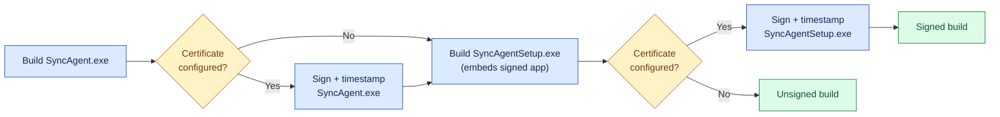

# Development guide

How the repository is organized, how to run Sync Agent from source, and how to build and release it.

## Repository layout

```text
sync_agent/
├── README.md                    Start here: what it is, install, setup, settings
├── CHANGELOG.md                 Release notes
├── build.bat                    Builds dist\SyncAgentSetup.exe and dist\SyncAgent\ (runs tests first)
├── pyproject.toml               Project metadata and pytest configuration
├── requirements.txt             Runtime dependencies
├── requirements-dev.txt         + pytest and PyInstaller
├── src/                         Application source (flat modules, entry point main.py)
│   ├── main.py                  Command line and start-up decision
│   ├── agent.py                 Runs watcher + worker + tray
│   ├── sync_engine.py           Sync passes, decisions, baseline
│   ├── storage.py               Conditional S3 operations
│   ├── config.py                Settings validation, paths, Windows registration
│   ├── wizard.py, reconfigure.py, helpers.py, ui.py   Console setup UI
│   ├── tray.py, icons.py        Tray menu and icon
│   ├── authentication.py, aws_cli.py                  AWS sign-in and CLI
│   ├── runtime.py, commands.py, watchers.py
│   └── installer.py             SyncAgentSetup.exe
├── scripts/                     Windows lifecycle scripts shipped inside the build
│   ├── install.ps1 / install.bat
│   ├── uninstall.ps1 / uninstall.bat
│   ├── ensure_aws_cli.ps1       Verified AWS CLI download/install (with consent)
│   ├── sign.ps1                 Code signing (used by build.bat and CI)
│   └── acceptance-test.ps1      One-command Windows 10/11 acceptance test
├── examples/
│   └── SyncAgent.config.example.json   Prepared settings template
├── docs/                        User and maintainer documentation (+ images/)
├── tests/                       pytest suite (offline by default)
└── .github/                     CI workflow, issue and pull request templates
```

Generated and ignored: `.venv-build/`, `build/` (PyInstaller work files, `.spec` files, generated icon), `dist/` (build output).

## Running from source

Requires 64-bit Python 3.10+ on Windows (3.12 recommended).

```bat
python -m venv .venv
.venv\Scripts\activate
python -m pip install -r requirements-dev.txt
python src\main.py --help
python src\main.py --status
python src\main.py --setup
```

From source, `python src\main.py` without options runs the agent in the foreground of the current console, which is handy for debugging; the installed `SyncAgent.exe` moves itself to the background instead. Source runs use the same per-user data folder (`%LOCALAPPDATA%\SyncAgent`) as an installed copy. To experiment safely, point `LOCALAPPDATA` at a temporary folder:

```bat
set LOCALAPPDATA=%TEMP%\sync-agent-dev
python src\main.py --setup
```

## Tests

```bat
python -m pytest            :: offline suite; reads settings from pyproject.toml
python -m pytest -k wizard  :: a subset
```

See [testing.md](testing.md) for the opt-in native packaged tests, live S3 test and manual release checklist. Tests must never use real credentials or production buckets.

## Building

```bat
build.bat
```

The build:

1. creates `.venv-build` with 64-bit Python (3.12 preferred) and installs `requirements-dev.txt`;
2. runs the full test suite and compiles `src`;
3. draws the application icon (`src\icons.py` → `build\SyncAgent.ico`);
4. builds `dist\SyncAgent\` with PyInstaller (one folder, `scripts\*.ps1` bundled) and copies the lifecycle scripts beside `SyncAgent.exe`;
5. builds `dist\SyncAgentSetup.exe`, a one-file installer embedding `dist\SyncAgent\`.

Any failing step stops the build.

## Code signing

Unsigned programs trigger *"Windows protected your PC"* and are more often flagged by antivirus. Signing is built into `build.bat` and CI and switches on as soon as a certificate is configured. It signs `SyncAgent.exe` before it is embedded in the installer, then `SyncAgentSetup.exe`, using SHA-256 and an RFC 3161 timestamp, so signatures stay valid after the certificate expires.



**1. Get a certificate.** A code-signing certificate is issued to a verified person or organization; it cannot be generated locally. Options:

| Option | Notes |
| --- | --- |
| **Azure Trusted Signing** | Low monthly cost; Microsoft-managed keys. Organization or individual identity validation. Use Microsoft's signing tool instead of a `.pfx`. |
| **OV code-signing certificate** (DigiCert, Sectigo, GlobalSign, SSL.com …) | Since 2023 issued on a hardware token or cloud HSM, so it is used with `-Thumbprint`. SmartScreen warnings fade as the signed file gains reputation. |
| **EV code-signing certificate** | Hardware token; strongest identity validation. |
| **Internal certificate** (company PKI) | Works on company PCs that trust your internal CA; external users still see warnings. |

**2. Build signed locally:**

```bat
:: Certificate file (.pfx); the password is read from the environment only
set SYNC_AGENT_SIGN_PFX=C:\certs\company-codesign.pfx
set SYNC_AGENT_SIGN_PASSWORD=********
build.bat

:: Or a certificate in your Windows certificate store (hardware token / EV)
set SYNC_AGENT_SIGN_THUMBPRINT=0123456789ABCDEF0123456789ABCDEF01234567
build.bat
```

Verify with `powershell Get-AuthenticodeSignature dist\SyncAgentSetup.exe`: the status must be **Valid**. `scripts\sign.ps1` can also sign files directly.

**3. Sign in CI.** Add two repository secrets (**Settings → Secrets and variables → Actions**):

| Secret | Value |
| --- | --- |
| `SIGN_PFX_BASE64` | `powershell "[Convert]::ToBase64String([IO.File]::ReadAllBytes('company-codesign.pfx'))"` |
| `SIGN_PFX_PASSWORD` | The `.pfx` password |

The workflow then signs both executables and fails unless both signatures are **Valid**. Without the secrets it builds unsigned, as before.

The pipeline was verified with a temporary self-signed test certificate: both files were signed with SHA-256, timestamped, and still ran correctly, including the one-file installer. A self-signed certificate is reported as untrusted by Windows, so it cannot replace a real one.

## Continuous integration

[`.github/workflows/windows.yml`](../.github/workflows/windows.yml) is **manual only**, to avoid spending Actions minutes on every push: **Actions → Windows distribution → Run workflow** (or `gh workflow run windows.yml --ref <branch>`). On a fresh Windows runner it:

- parses the PowerShell scripts;
- runs the offline suite and compiles the sources;
- runs `build.bat` and smoke-tests both executables;
- runs the native packaged install/upgrade/uninstall tests;
- uploads `SyncAgentSetup-windows` and `SyncAgent-windows` artifacts.

## Conventions

- **Safety first.** Never add an unconditional S3 overwrite or delete, a process kill, or a fallback that weakens a guard. New destructive behaviour must be opt-in and off by default.
- **No secrets in output.** Log and display exception *types* for AWS/credential errors, not messages.
- **Windows PowerShell 5.1** is the target for `scripts/`. Its quirks are pinned by tests: `Start-Process -PassThru` needs `$null = $process.Handle` before `ExitCode` is reliable, and `Get-ItemPropertyValue` throws on missing values even with `-ErrorAction SilentlyContinue`.
- **Keep the console usable when redirected.** `ui.py` switches redirected output to UTF-8; keep rich markup escaped (`_escape`).
- Match the surrounding style; add a regression test with every fix.

## Release checklist

1. Update the version in `src/ui.py` (`VERSION`) and `pyproject.toml`, and add an entry to [`CHANGELOG.md`](../CHANGELOG.md).
2. Run `build.bat` on Windows, or the manual CI workflow.
3. Run the native packaged tests and the manual checklist in [testing.md](testing.md) on clean Windows 10 and Windows 11.
4. Code-sign `SyncAgent.exe` and `SyncAgentSetup.exe` if you distribute them outside your own machines.
5. Create a GitHub release and attach `SyncAgentSetup.exe`.
