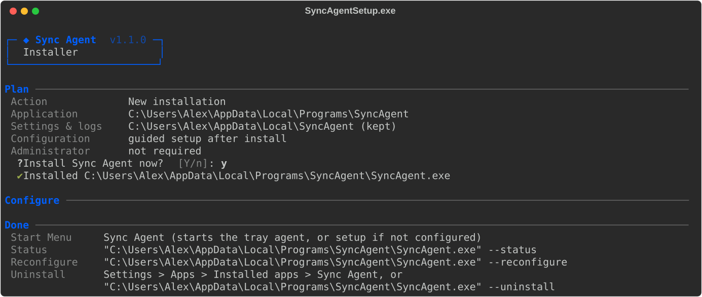

# Windows 10/11: build, set up and test Sync Agent

Use a disposable account/VM, a disposable local folder and a non-production S3 bucket/prefix first. Keep deletion propagation OFF. Live AWS acceptance (real S3 reads/writes) is still your responsibility; see [testing.md](testing.md).

## Quick start (most users)

1. Get `SyncAgentSetup.exe` (build it once, step 1 below, or download the **SyncAgentSetup-windows** artifact from the manual GitHub Actions workflow).
2. Double-click it. No administrator rights and no Python are needed.
3. Confirm the plan. The guided setup opens automatically and asks, one step at a time, for:
   - a computer name (pre-filled),
   - how to sign in to AWS (pre-selected: access keys) and the region,
   - the local folder (pre-filled: `%USERPROFILE%\Sync Agent Data`, created for you), the S3 bucket and prefix.

   A typo is reported immediately and that question is asked again; earlier answers are kept.
4. Answer **Y** to *Start Sync Agent now?*. A tray icon appears (it may be hidden under the **^** arrow).



Afterwards, open **Sync Agent** from the Start Menu at any time: it starts the tray agent, or opens setup if nothing is configured yet. Uninstall it from **Settings → Apps → Installed apps → Sync Agent**.

> **Windows SmartScreen / Defender:** the executables are not code-signed, so Windows may show *"Windows protected your PC"*. Choose **More info → Run anyway** only for a build you produced or downloaded from your own trusted workflow. Organizations should sign `SyncAgentSetup.exe` and `SyncAgent.exe` before wide distribution.

## 1. Build (source machine)

Install 64-bit Python 3.12 from python.org (tick *Add python.exe to PATH*; the `py` launcher is recommended). Open **Command Prompt (cmd)** in the extracted source directory, then run:

```bat
build.bat
```

`build.bat` picks Python 3.12 when available, refuses 32-bit Python, runs the full test suite, then produces:

- `dist\SyncAgentSetup.exe` — the single file to give to users;
- `dist\SyncAgent\` — the same application as a folder (keep it complete; do not copy only `SyncAgent.exe`).

Stop if the build reports a failed test or packaging error. Target machines do not need Python.

Before installing for ordinary use, you can run the opt-in packaged acceptance tests in a disposable account as described in [testing.md](testing.md). They refuse an existing SyncAgent startup or Installed-apps entry and temporarily create those entries themselves.

## 2. Install (target Windows account)

Double-click `SyncAgentSetup.exe`, or, for the folder build, run in cmd from inside `dist\SyncAgent`:

```bat
install.bat -NoStartup
```

From a source checkout after building, the same script is `scripts\install.bat` (it finds `dist\SyncAgent` automatically).

Install as the signed-in user, not from an administrator account. The application goes to `%LOCALAPPDATA%\Programs\SyncAgent`; settings, logs and baselines live separately in `%LOCALAPPDATA%\SyncAgent`. The installer also creates a **Sync Agent** Start Menu shortcut and a per-user **Installed apps** entry. Login startup is controlled by the *Start on current-user Windows login?* setup option; leave it off until the basic tests pass.

## 3. Choose authentication

The application requires AWS CLI. Setup checks for it and, if it is absent, asks before downloading the official per-user installer (about 50 MB; the Amazon signature is verified first). Background mode never installs it. If you use an organization-managed profile, provision it before completing the wizard.

### Access keys

Choose **1 — Access keys**. On a computer without a `sync-agent` profile, the wizard goes straight to entering an access key/secret and, for temporary credentials, the session token. The keys are checked against AWS STS; if they are rejected you can re-enter them. They are saved to the dedicated `sync-agent` profile only after you confirm the final review. Avoid long-lived keys when your organization offers SSO or certificate-based access. Shared AWS credential files are not encrypted storage.

### IAM Identity Center / browser SSO

Your AWS administrator must first grant account/role access to the test bucket. With AWS CLI installed, configure an organization-managed profile in cmd:

```bat
aws configure sso --profile company-sso
```

If `aws` is not recognized immediately after installation, open a new terminal. Choose **2 — Browser SSO**; the wizard lists the profiles it found and lets you correct a mistyped name. Approve saving settings, then approve browser sign-in when offered. You can sign in again later with the tray's **Sign in (SSO)** item or `--login`.

### Roles Anywhere / other profiles / workload chain

- **3 — Roles Anywhere:** your administrator must provision the trusted signing helper, certificate/private key and AWS role/profile. Select its existing `credential_process` profile. Sync Agent does not install or authenticate the helper; inspect and trust the configured command before using it.
- **4 — Workload/default SDK chain:** no explicit profile is selected. This is mainly for AWS-hosted workloads, not a way to give an ordinary Windows PC an IAM role automatically. Environment/default-profile credentials may take precedence; it is not role-only mode.
- **5 — Other existing profile:** select a trusted SDK-supported profile. Its configuration can execute local credential helper programs when credentials are requested.

Non-key choices do not rewrite shared AWS profile files. Browser login can update AWS token caches. STS identity success does not prove S3 permissions. Profile validation reads only the local AWS files; identity checks and synchronization can execute credential helpers. A hung credential helper is not bounded by the SDK's connection/read timeouts: verify that your trusted helper runs noninteractively before unattended use.

## 4. Setup choices for a first test

Setup runs automatically after a new installation. To run it again: Start Menu → **Sync Agent** (when not configured), the tray's **Reconfigure**, or:

```bat
"%LOCALAPPDATA%\Programs\SyncAgent\SyncAgent.exe" --setup
```

The bucket must already exist. A prefix such as `sync-agent-test/ws01` is fine; `s3://` and leading/trailing slashes are stripped for you. For initial testing:

- Use a new local test folder outside the application/settings folders.
- Use an empty test prefix to avoid first-sync conflicts.
- Keep both deletion options OFF.
- Leave automatic startup OFF until the basic tests pass.
- Review settings before saving. Only start synchronization when ready for actual S3 reads/writes and possible charges.

Every setting is explained in [configuration.md](configuration.md). A complete first run looks like this:


## 5. Check and operate

Everyday use goes through the tray icon: **Sync now**, **Show status**, **Check AWS identity**, **Open local folder**, **View live logs**, **Reconfigure**, **Uninstall** and **Quit**. Status and identity windows stay open until you press Enter.

The same actions are available from cmd (the installer does not add Sync Agent to PATH):

```bat
"%LOCALAPPDATA%\Programs\SyncAgent\SyncAgent.exe"              rem start the tray agent (or setup if unconfigured)
"%LOCALAPPDATA%\Programs\SyncAgent\SyncAgent.exe" --status
"%LOCALAPPDATA%\Programs\SyncAgent\SyncAgent.exe" --check-auth
"%LOCALAPPDATA%\Programs\SyncAgent\SyncAgent.exe" --login        rem SSO only
"%LOCALAPPDATA%\Programs\SyncAgent\SyncAgent.exe" --logs
"%LOCALAPPDATA%\Programs\SyncAgent\SyncAgent.exe" --reconfigure
"%LOCALAPPDATA%\Programs\SyncAgent\SyncAgent.exe" --stop
```

Starting the agent never leaves a console window open: it moves itself to the tray, also at Windows login and when Windows Terminal is the default terminal. A second start reports that the agent is already running. If the agent cannot start in the background (for example, a missing AWS profile), `--status` shows **Startup failed** with the reason.

## 6. Test before valuable data

Follow [testing.md](testing.md) separately on Windows 10 and Windows 11. Record actual exit codes and observed behavior; redact all credentials/tokens.

At minimum, test upload, download, simultaneous-change conflict preservation, default deletion behavior and restart. First sync treats a same-name path present on both sides as a conflict, even if bytes might match. Do not delete baselines to bypass conflicts or authentication-migration refusals; preserve both sides and review migration deliberately. Keep independent backups.

## 7. Uninstall

**Settings → Apps → Installed apps → Sync Agent → Uninstall**, the tray's **Uninstall**, or:

```bat
"%LOCALAPPDATA%\Programs\SyncAgent\SyncAgent.exe" --uninstall
```

Confirm removal. Uninstallation removes the application, its Start Menu shortcut, Installed-apps entry and login startup entry. It preserves local sync data, S3 data, settings, logs, baselines, AWS CLI and shared AWS credentials. Review retained credentials separately if the account or machine is being retired.
