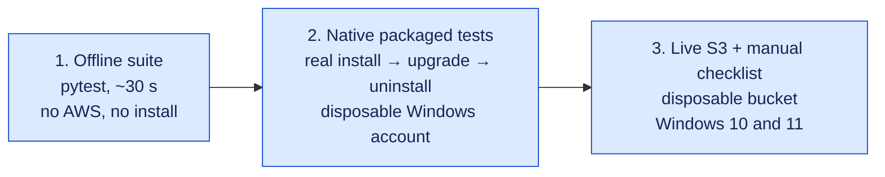

# Testing Sync Agent

There are three levels of testing, from safest to most realistic:



Passing tests at one level is not evidence for the next: mocked tests do not prove native Windows behaviour, and native tests do not prove S3 permissions or real syncing.

## 0. Offline suite (any developer machine)

From the repository root (tests import from `src/` via `pyproject.toml`):

```bat
python -m pip install -r requirements-dev.txt
python -m pytest
```

`build.bat` runs the same suite and stops the build on any failure. Expected result: everything passes. Five tests are skipped unless explicitly enabled: the live S3 test, two native bundle tests, and tests needing symlink privileges.

PowerShell lifecycle tests run the real `scripts\*.ps1` with process, network and registry calls mocked. They use Windows PowerShell 5.1 on Windows, or `SYNC_AGENT_TEST_PWSH=/path/to/pwsh` elsewhere.

### Latest recorded run — 2026-10-22, Windows 11 Home (10.0.26200), Python 3.11, Windows PowerShell 5.1

- Offline suite: **192 passed, 5 skipped, 21 subtests passed**.
- Native packaged tests (`tests/test_native_bundle.py` against a freshly built `dist\SyncAgent`): **2 passed**. These covered the frozen install, upgrade, uninstall, Start Menu shortcut, Installed apps entry and junction rejection.
- Manual: the one-file installer ran unattended into a temporary profile; the background agent ran against a dead local endpoint and stopped cleanly; tray actions and the confirmation dialog were exercised.
- Not run: Windows 10, live S3, AWS CLI download/MSI, real SSO or Roles Anywhere.

## 1. Native packaged tests (disposable Windows account/VM only)

Use separate clean 64-bit Windows 10 and Windows 11 VMs. A GitHub-hosted Windows runner is useful supplemental coverage but is not either desktop OS certification. Do not run the native test in an account with a real Sync Agent installation/startup entry. It refuses an existing `SyncAgent` Run value or Installed-apps entry, uses a temporary LOCALAPPDATA with spaces/non-ASCII and a temporary APPDATA for the Start Menu shortcut, and briefly registers current-user startup and the Installed-apps entry. It does not start a sync worker, download AWS CLI or contact AWS.

Build from the source root in cmd:

```bat
build.bat
```

Then in PowerShell, from the same root:

```powershell
$env:SYNC_AGENT_TEST_BUNDLE = (Resolve-Path .\dist\SyncAgent).Path
.\.venv-build\Scripts\python.exe -m pytest tests/test_native_bundle.py -q
Remove-Item Env:\SYNC_AGENT_TEST_BUNDLE
```

This executes the real frozen executable, actual install/upgrade/uninstall scripts and native HKCU startup readback. It verifies missing-config startup/login refusal, retained settings/baseline/local files, and junction rejection. It does not validate tray rendering, Windows login startup, downloaded MSI or browser authentication.

The Windows GitHub Actions workflow invokes these native tests after packaging, but is manual-only (`workflow_dispatch`). Uploading the source does not trigger a build, and no workflow run is claimed successful here.

## 2. Manual Windows UI/bootstrap matrix

On each clean OS, keep screenshots/results and actual exit codes, never tokens or private keys:

- Start without AWS CLI. Decline installation: verify no AWS CLI was installed. Approve on another clean snapshot: verify official MSI Authenticode/Amazon publisher, installation exit status and successful `aws --version`. Check actual UAC behavior; do not assume per-user MSI behavior from mocked tests.
- Repeat with an existing AWS CLI. Confirm detection does not download or replace it.
- Complete setup with disposable files. Verify tray visibility, folder/log actions, an immediate Sync now request, and second-instance rejection.
- Cancel setup and reconfiguration before saving: compare settings/shared AWS profile bytes and confirm the original agent keeps running. Bootstrap consent is separate from settings-save consent.
- Test SSO using a real administrator-provisioned profile. Before save, no browser login. After confirmation, explicit sign-in works. Expire the session: background mode must not open a browser. Use `--login` or the tray SSO item, then `--check-auth`. Restart the agent if it continues reporting an expired session.
- Test a trusted Roles Anywhere profile with a real administrator-provisioned helper/certificate and correct Windows path quoting. Verify short-lived credentials/refresh and refusal of ambiguous static credentials. The app does not authenticate the helper binary or provision PKI.
- Test the workload/default credential chain only in a deliberately configured AWS workload. Confirm which principal `--check-auth` uses; environment/default-profile credentials may take precedence over a role.
- Log out/in to Windows and verify startup; test enabling/disabling startup via reconfiguration. Inspect HKCU readback.
- Test stop during a slow transfer and an active-operation timeout. No forced process kill, duplicate worker or partially replaced local destination should occur.
- Test cancelled uninstall, successful upgrade/uninstall and injected failure rollback with disposable files. Verify synced data, config, baselines, AWS CLI and unrelated shared profiles remain intact.

## 3. Live S3 conditional-operation test (explicit opt-in)

An AWS administrator must provide a DISPOSABLE bucket and a trusted, already-authenticated profile. No credentials go into this repository or chat. Authorize list/get/put/delete only for `sync-agent-acceptance/*` in that bucket; list must be prefix-scoped. KMS encryption or bucket policies can require further permissions. Test requests can incur charges. With versioning enabled, old versions/delete markers can remain and must be reviewed separately by the bucket owner; this test never purges versions.

PowerShell example, after reviewing the target (replace placeholders):

```powershell
$env:SYNC_AGENT_LIVE_BUCKET = 'YOUR-DISPOSABLE-BUCKET'
$env:SYNC_AGENT_LIVE_PROFILE = 'YOUR-TEST-PROFILE'
$env:SYNC_AGENT_LIVE_AUTH_METHOD = 'profile' # or sso / roles_anywhere
$env:SYNC_AGENT_LIVE_REGION = 'eu-central-1'
$env:SYNC_AGENT_LIVE_S3 = 'I_ACCEPT_TEST_OBJECT_WRITES'
.\.venv-build\Scripts\python.exe -m pytest tests/test_live_s3.py -q
Remove-Item Env:\SYNC_AGENT_LIVE_S3
```

This creates a unique `sync-agent-acceptance/<UUID>/conditional-probe.txt`, verifies conditional creation/update/download/deletion and stale-ETag rejection, and reads back object state. Cleanup uses only that exact key and its last successfully returned ETag, never bulk or unconditional deletion. Failed/uncertain requests can leave a tiny test object: the bucket owner must review it. Custom endpoint environment overrides are refused. For workload-chain testing, use `workload_role` and no explicit profile in a controlled workload.

Without the exact opt-in, this test is skipped. Offline guard tests verify that missing bucket/profile or custom endpoints fail before constructing an S3 client. A passing storage test is not full end-to-end sync acceptance: also exercise first-sync conflicts, both-side edits, deletion defaults, opt-in deletion, restart tombstones, edits during transfers and token expiry with the full application on disposable data.

## Record results honestly

For every run record OS build, Python/package versions, source snapshot/revision, command, exit status and test totals. Mark skipped/native/cloud checks explicitly. Do not count authored tests, PowerShell parsing, fake stores or SDK Stubber runs as executed native Windows/cloud acceptance.
