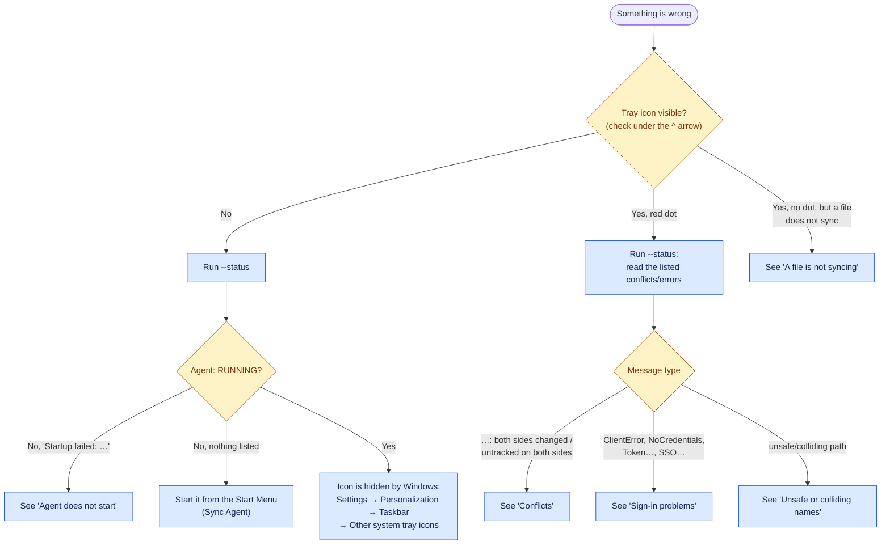

# Troubleshooting

Start with these two commands. They are also in the tray menu as **Show status** and **View live logs**.

```bat
"%LOCALAPPDATA%\Programs\SyncAgent\SyncAgent.exe" --status
"%LOCALAPPDATA%\Programs\SyncAgent\SyncAgent.exe" --logs
```

`--status` shows whether the agent is running, the result of the last pass, up to 20 conflicts or errors, and all settings. Logs are in `%LOCALAPPDATA%\SyncAgent\logs\`.



## Installation

**"Windows protected your PC" when starting `SyncAgentSetup.exe`.**
The program is not code-signed. Click **More info → Run anyway** if you built it yourself or got it from your own trusted source. Organizations should sign the executables.

**Antivirus quarantines `SyncAgentSetup.exe`.**
Self-extracting Python programs are sometimes flagged. Use the folder build (`dist\SyncAgent` + `install.bat`) or sign the executables, and report the false positive to your antivirus vendor.

**"Unrecognized installation directory; refusing to modify …".**
`%LOCALAPPDATA%\Programs\SyncAgent` exists but was not created by the Sync Agent installer. Move that folder away and run the installer again. Do not add a fake `SyncAgent.install.json`.

**"Application destination and configured sync folder overlap".**
Your saved `local_path` is inside the application folder (or the reverse). Choose another sync folder with `--setup`.

**"Cannot verify sync-folder overlap because settings are unreadable".**
`%LOCALAPPDATA%\SyncAgent\config.json` is damaged. Fix it, or rename it and run setup again.

**AWS CLI installation fails or times out.**
Install it manually from <https://docs.aws.amazon.com/cli/latest/userguide/getting-started-install.html>, then start Sync Agent again. Setup finds it automatically.

## Agent does not start

`--status` shows **Startup failed** with the reason:

| Reason | Fix |
| --- | --- |
| `AWS CLI not found; run SyncAgent.exe --setup interactively to install it.` | Run setup once interactively, or install the AWS CLI. |
| `AWS profile "…" was not found.` | The selected profile is missing from `%USERPROFILE%\.aws\config`. Recreate it, or choose another with `--reconfigure` → 2. |
| `Cannot read configuration …` / a validation message | Settings are invalid (for example the folder was deleted, or is now a link). Run `--setup`. |
| `Authentication baseline requires explicit migration review` / `Legacy baseline requires …` | See [the section below](#authentication-baseline-requires-explicit-migration-review). |

**"Sync Agent is already running."** Only one agent per Windows user can run. Use the existing tray icon, or `--stop` first.

## Sign-in problems

| Symptom | Fix |
| --- | --- |
| Errors on every file after a few hours, method SSO | The SSO session expired: tray → **Sign in (SSO)**, or `--login`. |
| `--check-auth` fails | Credentials are wrong or expired. For access keys: `--reconfigure` → 2 → enter new keys. |
| `--check-auth` succeeds but every file errors | The identity lacks S3 permissions for this bucket/prefix (or KMS). See [minimum permissions](authentication.md#minimum-aws-permissions). |
| Wrong AWS account shown by `--check-auth` (workload chain) | Environment variables or a default profile take precedence. Use a named profile instead. |

## Conflicts

A conflict means Sync Agent could not decide safely, so it changed nothing:

- **"untracked on both sides"**: the file existed locally and in S3 before the first successful sync of that path.
- **"both sides changed"**: the file was edited locally and in S3 since the last sync.
- **"deletion retained; manual resolution required"**: the file was deleted on one side earlier (deletion settings off) and now differs on the other side.

To resolve one, decide which version to keep, then make the other side match. For example, rename or delete the local file and let the S3 version download, or delete the object in S3 and let the local file upload. The next pass picks it up. With versioning enabled, overwritten S3 versions remain recoverable.

## A file is not syncing

- Is it excluded? Check `exclude_patterns` in `--status`. Patterns are case-sensitive, and Office lock files (`~$*`) are excluded by default.
- Is it in a subfolder while **Include subfolders** (`recursive`) is off?
- Is it larger than 5 GiB? Uploads above 5 GiB are refused.
- Was it changed in S3 while **Download from S3** (`sync_from_s3`) is off?
- Is the file still open and being written? It is retried on the next pass.
- Is it a link or shortcut to a folder (junction)? Links are never followed.

## Unsafe or colliding names

Windows cannot store some names that S3 allows: `CON`, `NUL`, `COM1`, names ending with a dot or space, names with `<>:"|?*`, or two names differing only by upper/lower case (`Report.pdf` and `report.pdf`). Such paths are listed as conflicts and skipped on both sides. Rename the objects in S3.

## Authentication baseline requires explicit migration review

Sync Agent found a baseline for the same folder/bucket/prefix that was recorded with a different sign-in identity or by an older version, and refuses to quietly start over (which could bring deleted files back). Choose one:

- **Go back** to the previous sign-in method with `--reconfigure` → 2, or
- **Start fresh deliberately:** stop the agent, make sure the local folder and the S3 prefix contain exactly what you want (one side empty is simplest), move the old `baseline-*.json` files from `%LOCALAPPDATA%\SyncAgent` to a backup folder, then start the agent. The first pass then follows first-sync rules.

## Tray and windows

**The tray icon is hidden.** Windows 11: **Settings → Personalization → Taskbar → Other system tray icons → Sync Agent: On**. Windows 10: drag it out of the **^** overflow area.

**The tray shows a red dot.** The last pass reported conflicts or errors; see `--status`. The dot clears after a clean pass.

**The status/identity window closes or waits.** Windows opened from the tray stay open until you press **Enter**.

## Removing Sync Agent completely

Uninstalling (Settings → Apps → Installed apps → Sync Agent) removes the program but keeps your data and settings. To also remove settings, logs and baselines, delete `%LOCALAPPDATA%\SyncAgent` afterwards. To remove saved access keys, delete the `[sync-agent]` section from `%USERPROFILE%\.aws\credentials` and `[profile sync-agent]` from `%USERPROFILE%\.aws\config`, and deactivate the key in AWS.
